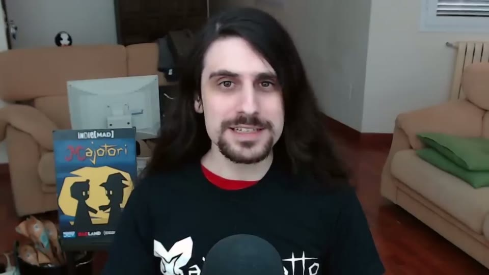
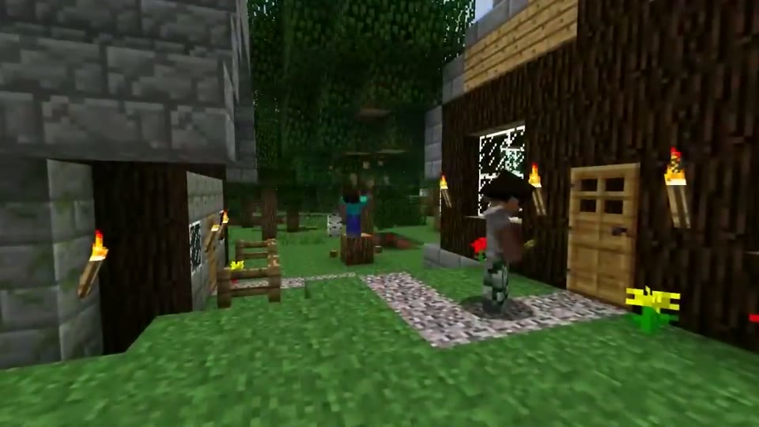
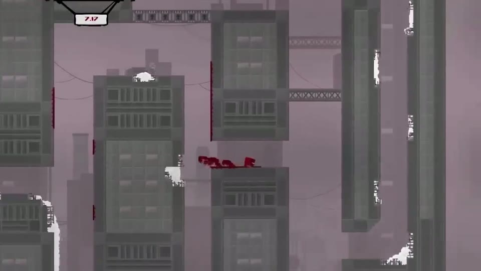
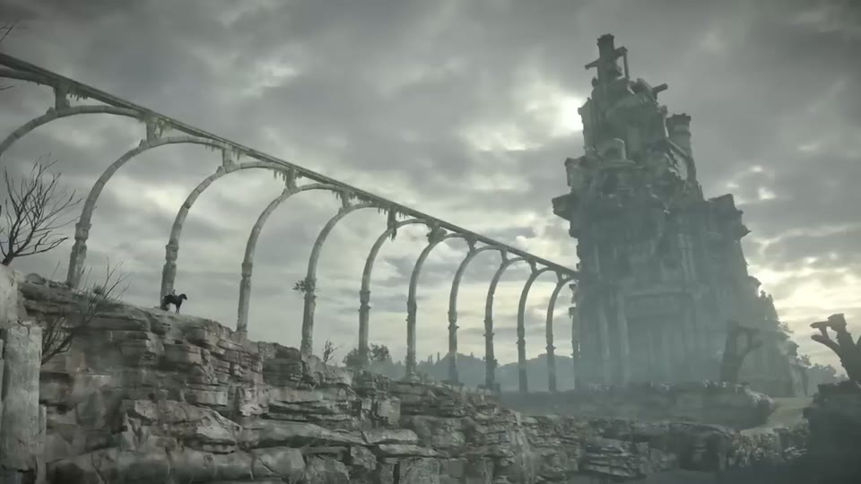
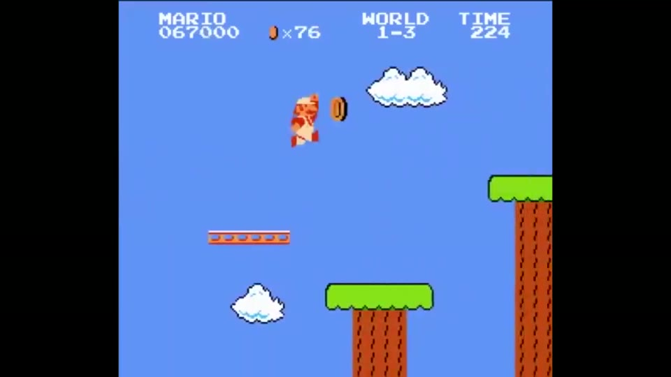
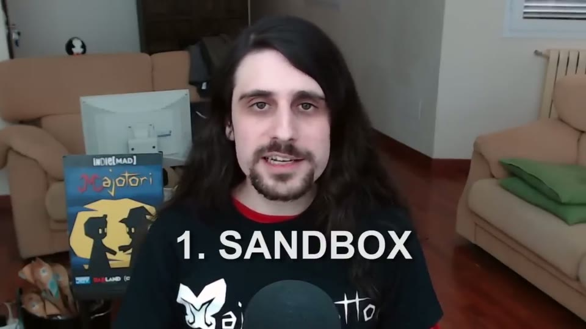

# Como diseñar videojuegos con sentido

- **Canal:** Alva Majo
- **Video:** <https://youtu.be/3hyJG6rTSSw>
- **Publicado:** 2019-06-05 · **Duracion:** 18:32
- **Transcripcion:** Whisper large-v3 (GPU, beam 10, idioma es) revisada a mano en nombres propios

## Resumen

Muchos desarrolladores solo saben de **generos**: copian los elementos de otros juegos sin entender por que funcionaban (el RPG con combates aleatorios aburridos, un mundo abierto donde no hay nada que explorar y "solo sirve para que el jugador se pierda y no sepa a donde tiene que ir", el viejo que te pide 20 troncos nada mas empezar).

**El diseño jugable** es crear un marco y unas mecanicas que provoquen el comportamiento o los sentimientos que quieres en el jugador. Dos pasos:

1. **Decide que quieres conseguir**: una *sensacion* (miedo, lo que te transmitio Final Fantasy VII), un *comportamiento* (en Minecraft que el jugador *quiera* construir) o *desarrollar una mecanica* (los portales de Portal).
2. **Añade solo elementos que lo consigan**, no cosas "al tuntun" porque otros juegos las tienen. Ejemplos de indies que deconstruyeron su genero: el terror en el que te escondes en vez de disparar, Super Meat Boy (niveles cortos y dificiles, vidas infinitas, reintentar al instante), Shadow of the Colossus (el juego va de los colosos y de soledad y magnitud: todo lo demas sobra).

**Las vidas** como ejemplo de algo que se copia sin sentido: nacieron en los arcades para cobrar monedas; despues se fue pasando de repetir todo, a repetir el mundo, el nivel, un checkpoint... y aun asi siguieron como "un numero mas en la pantalla".

**Una mecanica principal**, resumible en uno o dos verbos, muy pulida (en Mario: correr y saltar; todo el juego esta construido alrededor: matar saltando, romper bloques saltando, monedas para que recorras mas). Los niveles mas odiados son los que se alejan de ese verbo (casas de Boo, niveles de agua). Si el objetivo exige muchas mecanicas (Zelda: aventura epica) hay que seguir diseñando para guiar al jugador: **Ocarina of Time te obliga a tener espada y escudo antes de la primera mazmorra** para que no entres desarmado y te frustres. *"Si no quieres que el jugador haga algo, no dejes que lo haga"*, o como minimo animale a jugar como quieres (si la lanza es la clave contra los enemigos del bosque, ¡dilo!).

**Cinco tipos de juego** con valores distintos (mezclarlos sin cuidado acaba en tragedia; si se mezclan, uno debe dominar):

| Tipo | Valor | Clave de diseño |
|---|---|---|
| **Sandbox** | Objetivos emergentes | No decir "tienes que", sino lograr que el jugador diga "quiero" (la casa de Minecraft, Los Sims) |
| **Puzle** | El momento "¡eureka!" | Todas las piezas claras (o que este claro que falta una); simple de procesar; no es lo mismo complejo que bueno |
| **Competicion** | Superacion | Se siente *durante* el desafio; superarlo por reflejos, no por repetir 50 veces de memoria |
| **Estrategia** | Planificacion | Pocas piezas con muchas ramificaciones; ni demasiado facil ni demasiado complejo |
| **Fantasia** | Sensaciones por inmersion | Morir y volver atras rompe la inmersion (el monstruo que deja de dar miedo a la tercera vez) |

## Como se aplico en Beyond Small

**Que quiere conseguir Beyond Small:** la *fantasia* de ser diminuto en una casa gigante (asombro y vulnerabilidad), con dos verbos principales: **explorar** (correr, saltar, trepar por los muebles) y **pelear** contra los bichos, y un objetivo claro: encender la cabina con 4 baterias verdes que guardan cuatro "colosos". Con eso como guia:

- **Que el mundo abierto no sirva para perderse.** La cabina ahora rastrea las 4 señales de energia y la brujula las señala con su distancia (con "?" mientras no has descubierto el lugar). Arriba a la izquierda siempre esta el objetivo actual, que se escribe solo cuando cambia, y al descubrir una zona te dice que hay ahi ([`Objetivos.cs`](../../Assets/Progresion/Scripts/Objetivos.cs)). Se puede apagar en Ajustes > Pistas del objetivo.
- **"Si la lanza es la clave, dilo" / la espada y el escudo de Ocarina:** al acercarte a la zona de un jefe sin lo necesario el juego te avisa: Escudo o Guantes para las hormigas, Antorcha para las abejas, carne cocinada para la cloaca.
- **Nada al tuntun:** siete objetos que soltaban los bichos (hueso, piel, colmillo, cuerno, alas, aguijon, patas de ciempies) no servian para nada. Ahora alimentan cuatro mejoras que refuerzan los dos verbos ([`Mejoras.cs`](../../Assets/Progresion/Scripts/Mejoras.cs)): **Guantes** (golpes x1,5), **Botas** (saltas un 35% mas), **Planeador** (manten saltar en el aire para planear desde los muebles) y **Peto** (+50% de vida). La primera vez que recoges un ingrediente te dice que se puede crear.
- **Las vidas / Super Meat Boy:** al morir ya no vuelves siempre a la cabina a cruzar todo el mundo otra vez: despiertas en la entrada de la zona donde caiste si ya la conocias (hormiguero, arbol, alcantarilla o fogata) ([`Refugios.cs`](../../Assets/Progresion/Scripts/Refugios.cs)). La dificultad Extremo (una vida) se mantiene como opcion elegida, no como norma.
- **Puzles con todas las piezas a la vista:** en Hamsterlandia el objetivo dice cuantas palancas faltan (n/3) y que despues va la del escenario; durante la persecucion recuerda que la casita de Bolita tiene la puerta chiquita.
- **Mecanica principal pulida (Mario):** el salto y el golpe, que es lo que haces todo el rato, recibieron todos los trucos del video "Mejora la jugabilidad un 500%" y el juice del de Guinxu.

## Transcripcion completa

> Cada bloque empieza con su marca de tiempo. Las imagenes son fotogramas del video en ese momento.

**[0:00]** Hola, soy Alva Majo, desarrollador de videojuegos indie. La mayoría de desarrolladores de videojuegos

*0:01 — Alva Majo*

**[0:05]** novatos y muchos profesionales tienen muy poca idea de cómo funciona el diseño de juegos y sólo saben de géneros. En otras palabras, lo único que saben es copiar lo que han hecho otros juegos antes sin entender realmente cómo funciona. Esto a menudo resulta en juegos que no son tan divertidos porque no entienden lo que están copiando, así que lo copian de una manera superficial, perdiendo los elementos que lo hacían funcionar de verdad. Por ejemplo, casi todos los RPGs que me han enviado suscriptores para que pruebe son igual de malos y por los mismos motivos. ¿Los RPGs tienen combates por turnos que salen aleatoriamente? Pues yo en mi RPG pongo combates por turnos que salen aleatoriamente. ¿Qué tienen de divertidos esos combates? Ah, no sé, los míos desde luego son un coñazo donde lo único que tienes que hacer es repetir el mismo ataque todo el rato hasta que se acabe el combate. Pero, ¿los RPGs tienen combates por turnos? Mi juego tiene combates por turnos. Mi juego además tiene un mundo abierto que explorar. Es verdad que no hay nada interesante que explorar y sólo sirve para que el jugador se pierda y no sepa a dónde tiene que ir para que avance la historia, pero los RPGs tienen combates por turnos.

**[0:57]** Los RPGs que a mí me gustan también tienen un mundo abierto que explorar. Mi juego además está lleno de misiones secundarias. Nada más empezar, antes de que sepas siquiera de qué va la historia, hay un viejo que te pide que vayas al bosque y le consigas 20 troncos. ¿Es divertido? Hombre, pues dicho así no, pero en el fondo tiene que serlo porque en los RPGs que a mí me gustan hay muchas misiones secundarias. Esto ocurre porque no saben qué hace que un RPG sea divertido, no se han parado a estudiar el diseño, sólo saben que los RPGs tienen estos elementos así que si tú los pones en tu juego tienes un RPG. Esto también impide que seas capaz de ver, por qué tu juego no gusta. Si tiene todos los elementos que hacen al resto de RPGs divertidos, el tuyo también tiene que ser divertido, pero no es así. Por si todavía no ha quedado claro, estamos hablando de diseño jugable y no de diseño artístico o estético. El diseño jugable consiste en crear un marco y unas mecánicas que provoquen el comportamiento o los sentimientos que quieres que tenga el jugador. El diseño parte de tener claro qué es lo que quieres conseguir y consiste en encontrar formas de conseguirlo. El primer paso, por lo tanto, consiste en decidir qué es lo que quieres conseguir con el juego, qué es lo que quieres transmitir, cuál es tu objetivo. Ese objetivo puede ser una sensación, puede ser un comportamiento o puede ser desarrollar una mecánica. Una sensación sería, por ejemplo, el miedo. En un juego de terror lo que quieres es que el jugador pase miedo. También podría ser algo más abstracto pero a la vez concreto. Por ejemplo, quiero que mi juego transmita lo mismo que me transmitió a mí la primera vez que jugué al Final Fantasy VII. En ese caso tendrías que analizar cuáles son esas sensaciones y cómo replicarlas. Un comportamiento podría ser construir o ser creativo. En un juego como Minecraft no sólo

*2:18 — Minecraft: quieres que el jugador QUIERA construir*

**[2:22]** quieres que el jugador pueda construir, quieres que quiera construir y que pueda decidir qué es lo que quiere construir y cómo quiere construirlo. Esa es la gracia del juego. Por último, la base puede ser el desarrollo de una mecánica. Por ejemplo, los portales de portal. Se te ha ocurrido la idea de que tú pones dos portales y cuando te metes por uno sales por el otro. Es una idea muy interesante así que ahora tienes que desarrollar un juego que explote esa idea y le saque partido al uso de los portales. Una vez que has decidido el objetivo base del juego tienes que añadir mecánicos o elementos que ayuden directamente a conseguir ese objetivo. Es aquí donde copiar a otros juegos no te va a servir porque lo que pretendía otro juego a lo mejor no es lo mismo que lo que pretendes tú, incluso aunque sea un juego del mismo género. O a lo mejor simplemente hay un género que se ha construido con una base mala o ha ido evolucionando en una mala dirección y el resto de juegos simplemente lo han ido copiando y han ido arrastrando esas malas ideas sin pararse a arreglarlas o incluso empeorándolas aún más. De hecho, hay varios indies que se hicieron famosos precisamente por deconstruir su género eliminando o cambiando muchas ideas que no funcionaban al menos para conseguir un objetivo determinado. Con los juegos de terror, por ejemplo, hubo un resurgimiento hace unos años cuando a alguien se le ocurrió que da más miedo tener que esconderte de los monstruos que tener que dispararles. Parece obvio, pero la idea de que haya enemigos y no tengas que enfrentarte a ellos es prácticamente revolucionaria cuando en casi todos los juegos a los que has jugado si hay enemigos se pueden matar. Super Meat Boy, por ejemplo, es un juego que descartó la estructura clásica de los plataformas de tener que recorrer un nivel largo recogiendo moneditas y con vidas limitadas. En su lugar hicieron niveles muy

*3:42 — Super Meat Boy: niveles cortos, vidas infinitas y reintento instantaneo*

**[3:45]** difíciles pero muy cortos con vidas infinitas y que te permiten repetirlo al instante, de modo que consiguieron un resultado familiar que sigue siendo un plataformas pero a la vez único y más puro si lo que te gusta es ese tipo de desafío. Otro ejemplo es Shadow of the Colossus, que es un juego

*3:56 — Shadow of the Colossus: el juego va de los colosos; todo lo demas sobra*

**[4:00]** que va de encontrar y matar colosos. Cualquier otro juego habría imitado el género de aventuras y habría puesto aldeas y enemigos por el campo y los colosos estarían al final de una mazmorra llena de puzles. Pero Shadow of the Colossus no. Shadow of the Colossus es un juego que dijo, este juego va de los colosos y quiere transmitir una sensación de soledad y magnitud, así que todo lo demás sobra y el resultado es un juego único y maravilloso. Un caso concreto que quiero comentar para que veas que no solo porque todos los juegos de un género hagan algo quiere decir que ese algo esté bien, son las vidas limitadas. Todo empezó con los arcades en los que para jugar tenías que echar una moneda, así que tarde o temprano te tenían que matar para que tuvieses que seguir echando monedas y si dejabas de echar monedas pues tenías que volver a empezar desde el principio. Es un sistema que funcionaba para ese modelo de negocio. Luego llegaron las consolas y ahora ya no hacía falta matar al jugador todo el rato para que siga echando monedas porque ya había pagado por el juego, pero los juegos eran demasiado cortos por la limitación de memoria así que para alargarlos te daban tres vidas y cuando te mataban las tres vidas pues tenías que volver a empezarlo todo desde el principio. Los juegos han ido evolucionando desde entonces y se ha ido rechazando ese modelo cada vez más. ¿Por qué tengo que repetirlo todo desde el principio? Es verdad, a partir de ahora solo tienes que repetir el último mundo. ¿Por qué tengo que repetir todo el mundo? Es verdad, a partir de ahora solo tienes que repetir el último nivel. ¿Por qué tengo que repetir el nivel entero? Es verdad, vamos a poner varios checkpoints a lo largo del nivel y así solo tienes que repetir el último trozo. Hay juegos incluso en los que si te matan sales solo tres segundos antes y solo tienes que repetir la última acción que has hecho.

**[5:22]** Sin embargo, la mecánica de las vidas se ha estado manteniendo incluso años después de que hubiesen perdido el sentido prácticamente por completo. ¿Por qué? Pues porque los juegos de plataformas tienen vidas así que yo estoy haciendo un juego de plataformas y le pongo vidas. Incluso en Nintendo, que son expertos en diseño, solo recientemente han decidido eliminar las vidas de los juegos de Super Mario pese a que hacía años que no servían absolutamente para nada, solo eran un número más en la pantalla. ¿Cómo es posible eso si se les da también el diseño? Pues puede que estuviesen confiando en una fórmula que funciona y por varios motivos no se atreviesen a que simplemente les pareciese que las vidas son un elemento demasiado icónico de los Super Marios y no quisiesen quitarlo. La moraleja es que solo porque todos los demás lo hagan no quiere decir que no sea estúpido. Es posible que haya un buen motivo detrás, pero como diseñador deberías entender cuál es ese motivo. Volvemos a cómo diseñar un juego. Paso 1, decide qué es lo que quieres conseguir. Paso 2, añade elementos que lo consigan. Solo elementos que lo consigan, no añadas cosas al tuntún simplemente porque hay otros juegos que también lo hacen. Así es como conseguirás un juego puro con mecánicas pulidas y que consigue lo que quiere conseguir.

**[6:22]** ¿Y qué pasa si la sensación que quiero que transmita mi juego es diversión en general? Pues que tienes que ser más concreto, porque si no acabarás metiendo un popurrí de elementos y el resultado probablemente sea una mezcla mediocre. Esto es algo que pasa con muchísimos videojuegos, que en vez de tener unas pocas mecánicas bien pulidas para una experiencia destilada, tienen un montón de mecánicas superficiales que con suerte al final cuando las juntas todas, pues el resultado es suficientemente entretenido. Para la mayoría de casos lo recomendable es que encuentres una mecánica principal y construyas el resto del juego en torno a esa mecánica, añadiendo otras mecánicas y elementos que la complementen en vez de tener varios sistemas separados. Esta mecánica principal normalmente se puede resumir en uno o dos verbos, que son las acciones más frecuentes que realizas a lo largo del juego. Por ejemplo, ¿cuál es la mecánica principal en un juego de Super Mario? Moverse. El juego va de moverse. O más concretamente, de correr y saltar. Por eso correr y saltar suele ser la parte que está más pulida en los juegos de Super Mario, porque tiene que sentirse bien y ser divertido incluso en un escenario vacío, porque es lo que vas a estar haciendo constantemente. El resto del juego está de correr y saltar. ¿Cómo se matan a los enemigos? Saltándoles encima. ¿Cómo se rompen los bloques?

*7:24 — Super Mario Bros.: todo el juego gira en torno a correr y saltar*

**[7:26]** Saltándoles por debajo. ¿Cómo están diseñados los escenarios? Pues de manera en la que tengas que correr y saltar de formas interesantes. ¿Por qué hay monedas repartidas por el escenario? Para que en vez de correr solo hacia la derecha tengas que correr y saltar por más partes del escenario. ¿Cuándo pierdes? Cuando te mueves de la forma en la que no te tenías que haber movido. ¿Cuáles suelen ser los niveles más odiados? Las mansiones de los Boo. ¿Por qué? Porque no van tanto de correr y saltar como de resolver algún tipo de puzzle. También los niveles submarinos, nadar en el agua no se siente tan bien como correr y saltar, y las mecánicas que están diseñadas para correr y saltar no funcionan tan bien debajo del agua. Existe la posibilidad de que el objetivo de tu juego implique muchas mecánicas diferentes. Por ejemplo, en The Legend of Zelda Ocarina of Time puedes luchar, puedes explorar, puedes resolver puzzles, puedes pescar, puedes montar a caballo, etcétera, etcétera. Cada una de estas mecánicas por separado no son la gran cosa, pero cuando las juntas todas consigues esa sensación de aventura épica que es lo que busca ese juego. Aún así, tienes que seguir diseñándolo todo de forma que consiga que el jugador se comporte como tú quieres. ¿Por qué Ocarina of Time te obliga a conseguir la espada y el escudo antes de dejarte entrar a la primera mazmorra? Porque no quiere que entres desarmado, los enemigos te maten y te sientas frustrado porque no sabes cómo evitarlo. Este es uno de los grandes defectos de los RPGs que me envían de los que hablaba antes. Nada más empezar te dicen que tienes que ir al bosque, así que voy al bosque y cada diez pasos que doy me sale un combate aleatorio con un enemigo que dura cinco minutos y lo único que puedo hacer es repetir el mismo ataque que tengo una y otra vez. Eso es aburridísimo, así que dejo de jugar. Pero no, es que se supone que tienes que ir primero a la tienda a comprarte una lanza porque la lanza es más efectiva contra los enemigos del bosque y así los combates son más cortos porque los matas de un golpe. Bueno, pues si se supone que tengo que matarlos con una lanza, ¿por qué nadie me lo ha dicho? Porque el juego me deja jugarlo de forma que es increíblemente aburrida y me hace pensar que lo estoy haciendo bien. Todo esto se podría reducir a la expresión, si no quieres que el jugador haga algo, no dejes que lo haga. Normalmente no es tan fácil porque la mayoría de juegos requieren cierto grado de libertad que permite que el jugador la líe, pero tienes que considerar un diseño que, como siempre, no es tan fácil. Si no quieres que el jugador haga algo, como mínimo, anime al jugador a jugar de la forma que tú quieres que juegue. No pongas un mapa de mundo abierto si quieres que vaya a las ciudades en orden. No me dejes ganar combates repitiendo el mismo ataque todo el rato si quieres que use gran variedad de ataques. No pongas una dificultad exagerada si no quieres que me estén matando todo el rato, etc. De todas formas, si eres un indie no te recomiendo ir por la ruta del simulador de aventuras porque cuantas más mecánicas, más trabajo, menos tiempo para pulirlas y conseguir que al final encajen todas en un resultado bueno y coherente en vez de en basura genérica es más difícil de lo que parece.

**[9:46]** Pasemos ahora a un poco de interesante teoría para ayudarte a encontrar qué tipo de juego quieres hacer y cómo conseguirlo. Podemos dividir los juegos en cinco tipos fundamentales, cada uno con sus propios valores. Es importante saber esto porque mezclar diferentes tipos suele terminar en tragedia. El primero es el sandbox. Un sandbox es un juego sin estructura que consiste

*10:00 — 1. Sandbox*

**[10:03]** en explorar uno o varios sistemas. En otras palabras, es un juego en el que puedes hacer lo que quieras. No hay un objetivo concreto. El objetivo es jugar a secas. Un ejemplo sería Minecraft. Aunque técnicamente tiene un final, el juego no va a llegar a ese final y pasárselo, sino que va a explorar el mundo y los sistemas que te ofrece, lo que en la práctica va a consistir en explorar y construir. El valor de un sandbox está en los objetivos emergentes. Al diseñar un sandbox, lo que tienes que hacer no es decirle al jugador tienes que hacer esto, sino conseguir que el jugador diga quiero hacer esto. Nadie te obliga a construir una casa en Minecraft, pero absolutamente todo el mundo que juega, una de las primeras cosas que hace es construirse una casa. ¿Por qué? Porque las mecánicas del juego te incitan a querer construir una casa. Otro ejemplo sería los sims, donde tampoco hay objetivos, sino que tú te creas un personaje, te construyes una casa, la vas creando, creas relaciones con otros personajes, te casas, tienes un hijo, te ascienden en el trabajo, etcétera. Nadie en ningún momento, al menos en los originales, te dice que tengas que hacer esto, pero tú lo haces igualmente porque es divertido hacerlo. Así que lo que tienes que hacer con un sandbox es dar herramientas con las que sea divertido jugar. El siguiente tipo de juego es el puzzle. Un puzzle consiste en encontrar la solución a un problema. Para ello, lo recomendable es darle todas las piezas al jugador en sentido metafórico, es decir, que todas las mecánicas o objetos necesarios para resolver ese puzzle estén claros, que el jugador sepa lo que quiere, que el juega lo que tiene que hacer, pero no sepa cómo tiene que hacerlo. Hay varias cajas bloqueando el camino y tengo que empujarlas o estirarlas de algún modo que lo despejen en vez de bloquearlo todavía más. Ese sería un ejemplo de puzzle. Sin embargo, ese sería un ejemplo mediocre porque el valor de los puzzles está en el momento de Eureka. Ese momento en el que tu cerebro hace una conexión que antes no estaba ahí y pasas a entender algo que antes no entendías. Ah, claro, tengo que colocar primero las cajas que están a los lados para luego tener hueco y poder apartar las que están en medio.

**[11:41]** Ese sería un ejemplo un poco cutre de un momento de Eureka. Es por eso que es preferible que todos mis puzzles estén claros desde el principio o, si falta alguno, también esté claro que hay algo que falta, porque no hay nada más frustrante que estar 15 minutos dándole vueltas a un puzzle y que luego resulte que para resolverlo necesitabas un objeto que estaba en otra habitación y no lo sabías. Mucha gente confunde el valor de los puzzles con la dificultad o la complejidad. Ahora, en vez de tener que apartar 10 cajas, hay 20 cajas y en el siguiente nivel hay 40 cajas y además hay columnas por la habitación. Solo añadir complejidad no crea buenos puzzles. Esa complejidad tiene que estar acompañada de nuevas conexiones lógicas que te den ese sentimiento de haber descubierto algo nuevo y no solo la sensación de estar perdiendo tiempo empujando cajas. De hecho, un buen puzzle tiene que ser lo suficientemente simple como para que puedas procesarlo entero en tu cabeza y que ese proceso no sea tan costoso que no sea divertido hacerlo. Si hay 50 palancas y cada palanca hace una cosa diferente y tienes que probarlas todas y memorizar qué es lo que hace cada una y luego procesarlo toda la vez para descubrir en qué orden tienes que activarlas, pues eso es un puzzle muy complejo, pero no es un puzzle divertido. Un puzzle solo tiene valor la primera vez que lo resuelves, porque una vez que sale la solución, volver a resolverlo es simplemente una tarea mundana, una pérdida de tiempo. Aunque puedes cambiar las piezas de lado y eso lo hace un poco más entretenido, si la lógica en sí ya la has descubierto antes, pues no tiene tanta gracia. Debería ser obvio ahora que criticar un juego de puzzles por no ser rejugable es estúpido y sin embargo es algo que hace muchísima gente precisamente porque no saben que no todos los tipos de juegos son iguales. Solo porque sea divertido jugar decenas o cientos de veces a un juego arcade no quiere decir que todos los juegos tengan que ser igual de divertidos de rejugar y si no es que están mal hechos. El siguiente tipo de juego es la competición. Una es un juego que mide tu habilidad de una forma u otra. Los juegos arcades son todos competiciones, cuanta más habilidad, más puntos consigues. La mayoría de juegos en los que tienes que superar algún tipo de nivel para poder avanzar son competiciones que te están puntuando con solo dos notas, o aprobado o suspenso, o te pasas el nivel o no te lo pasas y tienes que repetirlo hasta que te lo pases. Los juegos multijugador también suelen ser concursos, demostrar más habilidad y control de las mecánicas del juego que tu rival. El valor de las competiciones es la sensación de superación, pero ojo porque no es exclusivamente lo que sientes en el momento en el que superas durante la superación del desafío. Es por eso que pasarte un nivel a la primera puede darte más sensación de superación porque has tenido que improvisar y has usado tus reflejos ninja para pasarte nivel que tener que estar repitiendo el mismo nivel 50 veces y tener que aprendértelo de memoria para poder superarlo. En el primer caso sientes que te has enfrentado a un desafío de habilidad y lo has superado porque eres bueno y en el segundo sientes que te has enfrentado a un desafío de frustración y desesperación y que lo has superado a base de paciencia. La sensación de superación la puedes tener igual al final, puede que después de haberte pasado ese desafío te sientas súper orgulloso de no haberte rendido, pero la sensación de superación en sí no es algo que requiera todo ese tedio. De hecho, ni siquiera requiere superar el desafío. En los juegos multijugador, por ejemplo, siempre que una partida sea reñida va a ser divertido porque hay momentos dentro de la propia partida en los que tú estás superando al rival, momentos en los que él te está superando a ti y al final el que gane pues disfruta un poco más, pero os lo habéis pasado bien los dos porque habéis estado sintiendo esa sensación de superación a lo largo de la partida, incluso aunque luego al final termines perdiendo. El siguiente tipo de juego es la estrategia. Un juego de estrategia es como una competición, solo que en vez de ser una competición de habilidad es una competición de toma de decisiones. No se trata de ser el que tiene mejores reflejos, sino de ser el que ha planeado mejor sus jugadas. Un juego de estrategia en el fondo es como un puzzle suficientemente profundo como para que no puedas resolverlo. No se trata de encontrar la estrategia que supera a todas las demás estrategias posibles, sino la que supera el desafío al que te estás enfrentando. Al final es un poco como resolver un puzzle que tiene muchísimas soluciones y tú lo único que tienes que hacer es encontrar una de ellas. El valor de un juego de estrategia está en la planificación, el mero hecho de pensar qué decisiones vas a tomar es lo que hace un juego de estrategia divertido.

**[15:18]** Para eso, planificar una estrategia tiene que ser interesante. Si es aburrido porque es demasiado fácil o demasiado complejo, no funciona. ¿Cómo haces que una estrategia sea interesante? Mezclando superación con eureka, haciendo un sistema que te incite a enseñar tu buena toma de decisiones y te permite hacer nuevas conexiones lógicas. Esto normalmente se consigue con profundidad y con mecánicas emergentes, haciendo que con pocos elementos haya muchas posibles ramificaciones y que explorar y considerar las diferentes combinaciones sea interesante. El último tipo de juego es la fantasía, o el simulador de fantasía si lo prefieres. Una fantasía consiste en transmitirte sensaciones o hacerte vivir situaciones. Las novelas visuales, algunos juegos de terror o los juegos narrativos como Detroit Become Human son fantasías. En estos juegos a menudo tienes que tomar decisiones, pero las decisiones no son estratégicas sino dramáticas.

**[16:02]** El juego te pone una situación ficticia y te pregunta ¿qué harías tú en una situación así? y te permite expresarte y vivir las consecuencias de tus acciones. El valor de las fantasías son las sensaciones o emociones que te transmite y eso se concentra en el juego. El valor de fantasía es la sensación que consigues a través de la inmersión. Antes he dicho que mezclar varios de estos tipos de juegos suele terminar en tragedia, pero si te pones a pensarlo seguro que muchos de tus juegos favoritos mezclan varios de estos tipos, sobre todo algún otro tipo con fantasía. Casi todos los juegos mezclan fantasía. Es verdad que se pueden mezclar, pero tienes que ser muy consciente de que estás mezclándola para evitar liarla y hacer, por ejemplo, un puzzle en el que tienes que tomar decisiones, porque eso va a convertirse en un juego de ensayo y error que probablemente no es lo que querías. Cuando se juntan varios tipos de juego con éxito suele ser porque uno de esos tipos está dominando a los demás, porque si están todos al mismo nivel cada uno tiene valores diferentes y el resultado no funciona. Por ejemplo, un género muy habitual son los puzzles plataforma, que son juegos en los que tienes que resolver puzzles pero te mueves con un juego de plataformas.

**[16:55]** Sin embargo, todos los juegos que hacen bien esta mezcla o las plataformas son difíciles y los puzzles son triviales o los puzzles son difíciles y las plataformas no requieren prácticamente ningún tipo de habilidad. Esto es porque para resolver puzzles tienes que pensar, pero no puedes pensar bien si tienes que estar atento a dar los saltos como toca. Además, si se te da bien resolver los puzzles el juego va a ser frustrante si no puedes introducir la solución porque te están matando y si se te dan bien las plataformas, la habilidad, también va a ser frustrante si estás dando vueltas y no encuentras cómo tienes que resolver el puzzle. Con la fantasía pasa lo mismo. En la mayoría de juegos, aunque hay fantasía, esa fantasía está en un plano secundario y se rompe tarde o temprano, porque cuando te matan y vuelves a una parte anterior del juego esa inmersión de estar metido en la historia se rompe. Ese es el problema de la mayoría de juegos de terror, que al principio dan mucho miedo, pero en cuanto el monstruo te pilla tres veces ya deja de dar miedo porque deja de ser algo emotivo y pasa a ser algo puramente mecánico. La parte de la competición, de tener que hacerlo suficientemente bien como para que no te pille el monstruo, se está poniendo por encima de la parte de la fantasía que crea la inmersión y el miedo. Todo esto de los tipos de juegos es sólo una forma teórica de clasificarlos y hay que tomárselo como una herramienta que te ayude a diseñarlos o analizarlos y no como una verdad universal o la única forma posible o la mejor de categorizar los juegos, aunque a mí personalmente es la que me parece más útil. Tampoco estoy diciendo que la forma que he explicado de diseñar videojuegos sea la única forma válida o la mejor, cada uno que diseñe los juegos como le dé la gana, pero me parece personalmente que la forma más útil de hacerlo es centrarte en los comportamientos o las sensaciones que quieres transmitir y diseñar el resto del juego en torno a ello. Eso es todo, es posible que en algún momento haga un vídeo analizando el diseño de mis juegos y explicando por qué tomé cada decisión, así que suscríbete al canal para no perdértelo.
