# Mejora la jugabilidad un 500%

- **Canal:** Alva Majo (con explicaciones de codigo en Unity de TheValen)
- **Video:** <https://youtu.be/qf9vq-ru2Ks>
- **Publicado:** 2021-07-21 · **Duracion:** 16:27
- **Transcripcion:** Whisper large-v3 (GPU, beam 10, idioma es) revisada a mano en nombres propios

## Resumen

Alva Majo prueba cada semana juegos de sus suscriptores y ve siempre los mismos fallos basicos. Son trucos poco intuitivos pero faciles de aplicar que hacen que incluso un juego sencillo deje de ser frustrante:

1. **Coyote Time**: dejar saltar un instante (p. ej. 0,25 s) despues de salirse del borde. Hay un retraso entre ver, pulsar y que el juego reaccione, y los frames pueden saltarse el punto exacto. No hay un valor perfecto: prueba hasta que se sienta bien sin que se note que saltas en el aire. Ojo con no permitir doble salto por accidente.
2. **Tamaño de los colliders**: lo que te mata, un poco *mas pequeño* que su dibujo (mejor atravesar un poco que morir sin que te toquen); lo que quieres coger (monedas), un poco *mas grande*. Se pueden usar dos colliders en capas distintas.
3. **Posicion y movimiento de la camara**: no seguir al milimetro (marea), no centrar al personaje (importa lo que viene, no lo recorrido), sin cambios bruscos de lado, a una distancia adecuada. **Siempre se tiene que ver hacia donde vas**: "el jugador no es adivino". En Unity: Cinemachine con *lookahead* 0,5, *Lookahead Smoothing* 6 e ignorar la Y para que no se vuelva loca al saltar.
4. **Input buffer**: como el coyote time pero al reves. Si pulsas saltar justo antes de tocar el suelo, el juego lo guarda y salta al aterrizar (el triple salto de Mario). En combos se puede ser muy generoso: pulsas la combinacion y el personaje la ejecuta a su ritmo. En Unity: una cola (Queue) de acciones que caducan a los 0,5 s.
5. **Correccion de esquinas**: si al saltar la cabeza roza un borde, recolocar al personaje hacia el lado libre en vez de darse el cabezazo (Super Mario Bros. ya lo hacia).
6. **Feedback**: tiene que estar claro lo que consiguen tus acciones. Si le haces daño a un enemigo, que se vea; si **no** le haces daño, que tambien se vea. Si pulsas y no pasa nada (sin balas), como minimo un sonido y una animacion, e idealmente señalar el motivo (que el contador de balas se agite).
7. **Diferentes alturas de salto**: saltar mas alto manteniendo el boton y mas bajo con un toque. Elegir bien si el personaje "flota" o "es un plomo" segun el juego.
8. **Claridad visual**: separar bien fondo y elementos; lo importante (proyectiles incluidos) tiene que verse claramente aunque no sea realista.
9. **Buen diseño de niveles**: secciones pequeñas, cada una con una combinacion interesante de movimientos; tener suficientes elementos para combinar (plataformas moviles, pinchos, enemigos con patrones...) y alguno unico de tu juego; y que el nivel parezca parte de un mundo (un puente, una cueva) y no bloques de LEGO.

## Como se aplico en Beyond Small

| Truco | En el juego |
|---|---|
| 1. Coyote time | 0,15 s para saltar despues de salirse de un borde, sin doble salto ([`PlayerController.cs`](../../Assets/Personaje_principal/PlayerController.cs)) |
| 2. Colliders | Los bichos ya atacan por distancia; lo que se gano aqui es que tras un golpe hay 0,35 s de invulnerabilidad para que no te encadenen golpes sin poder reaccionar ([`PlayerHealth.cs`](../../Assets/Personaje_principal/PlayerHealth.cs)) |
| 3. Camara | Lookahead 0,3 s con suavizado 6 ignorando la Y, mas amortiguacion vertical que horizontal (saltos sin tirones) ([`CamaraViva.cs`](../../Assets/Juice/Scripts/CamaraViva.cs)). Y "el jugador no es adivino": ahora la cabina rastrea las 4 baterias y la brujula las señala ([`Objetivos.cs`](../../Assets/Progresion/Scripts/Objetivos.cs)) |
| 4. Input buffer | Saltar 0,18 s antes de tocar el suelo sale al aterrizar; un clic de ataque en el aire o con el escudo arriba se guarda 0,2 s; el combo ya encolaba golpes |
| 5. Correccion de esquinas | Si la cabeza choca con un borde al saltar, el personaje se recoloca hacia el hueco libre. Ademas ya no se puede levantar de agachado si hay techo encima |
| 6. Feedback | Numeros de daño al pegar ([`NumerosDanio.cs`](../../Assets/Juice/Scripts/NumerosDanio.cs)); si el golpe no hace nada (armadura, enterrado) salen chispas grises, un "clink" y un aviso; sin stamina la barra se agita en rojo y suena un resoplido ([`PlayerStamina.cs`](../../Assets/Personaje_principal/PlayerStamina.cs)); el golpe cargado ahora pega el doble |
| 7. Alturas de salto | Soltar el boton mientras subes corta el salto; mantenerlo flota un poco en la cumbre |
| 8. Claridad visual | El loot nace con un destello y rebote para que se vea; las señales de bateria laten en la brujula |
| 9. Niveles | Las mejoras nuevas (Botas, Planeador) dan nuevas formas de recorrer los muebles y el jardin |

## Transcripcion completa

> Cada bloque empieza con su marca de tiempo. Las imagenes son fotogramas del video en ese momento.

**[0:00]** ¡Hola! Soy Alva Majo, desarrollador de videojuegos indie. Cada semana pruebo decenas de juegos que me envían mis subs y muchos de ellos sufren de fallos básicos que empeoran bastante la jugabilidad y hacen que incluso un juego sencillo sea frustrante. Por suerte, mejorar estos fallos y hacer juegos mucho más agradables de jugar no es muy difícil. Basta con aplicar unos cuantos trucos básicos, pero que si eres novato puede que no los conozcas y simplemente no se te hayan ocurrido porque no son necesariamente intuitivos, así que en este vídeo te los voy a explicar. Vamos a empezar por el Coyote Time, uno de los más importantes y que usan todos los juegos buenos, pero rara vez lo veo en los juegos que me envían mis subs.

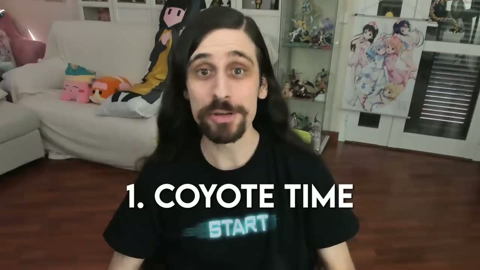
*0:26 — 1. Coyote Time*

**[0:32]** El nombre de este truco viene de los dibujos animados de El Coyote y el Correcaminos, donde el coyote corría más allá de un acantilado, pero no se empezaba a caer hasta que se daba cuenta de que no había suelo debajo de sus pies. En los videojuegos, especialmente los de plataformas, es habitual intentar saltar en el último momento justo antes de que deje de haber suelo debajo de tus pies para así llegar más lejos. En algunos juegos es incluso necesario que saltes justo en el último momento para poder llegar a la siguiente plataforma. Saltar justamente en el último momento es muy difícil. Saltar justo al final de una plataforma es bastante difícil no solo porque requiere buenos reflejos, sino también porque hay cierto retraso desde que tus ojos reciben una imagen hasta que la procesas, pulsas el botón y el juego reacciona. Además, un videojuego se mueve por frames, lo que significa que tal vez el punto exacto en el que el personaje está justo al final de la plataforma no llegue a existir y pasa de ser demasiado pronto a ser demasiado tarde.

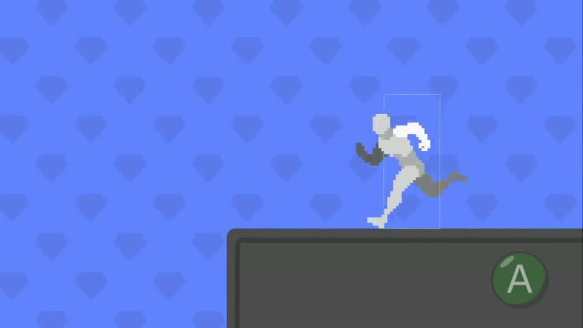
*1:14 — Saltar justo al final de la plataforma*

**[1:16]** Todo esto desemboca en que el jugador intente saltar justo al final, el personaje no salte porque ha registrado el botón demasiado tarde y el jugador se siente frustrado porque parece que el juego no está respondiendo bien a los controles. La solución es, en primer lugar, no poner nunca un salto tan ajustado que haya que saltar justo al final o si no, no llegas. Pero aunque no tengas ese tipo de saltos, la gente va a intentar saltar justo al final igualmente, así que el segundo paso es añadir el Coyote Time. Este truco consiste simplemente en permitir que el personaje salte durante un breve momento después de haberse despegado del suelo. Pasemos con TheValen para que nos explique exactamente cómo implementar el Coyote Time en Unity. ¡Hola! La forma más fácil de implementar Coyote Time en tu juego es utilizar un Raycast.

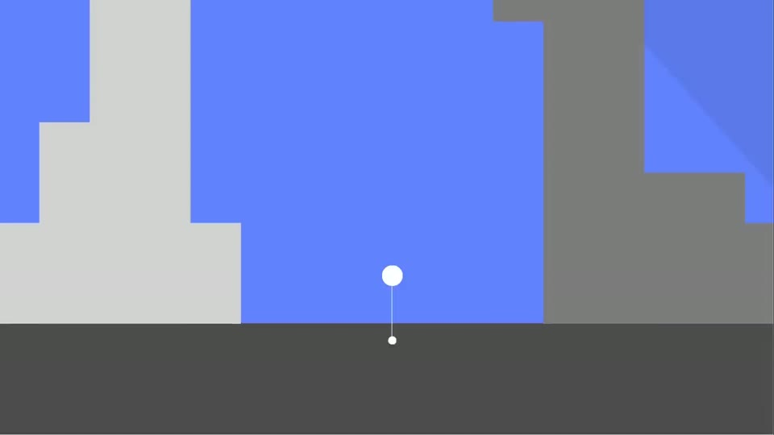
*1:51 — El raycast hacia el suelo*

**[1:52]** Un Raycast es esta línea de aquí. Tiene un inicio, un final... y sirve para detectar todo lo que está tocando, como por ejemplo, el suelo. Nuestro personaje se mueve hacia los lados y salta utilizando este código. Antes de nada, tenemos que ir al inspector de Unity y crear una capa llamada suelo. Una vez creada, tenemos que seleccionar el suelo y ponerlo en esta capa. Este código representa el Raycast. Indicas la posición inicial, la dirección, la longitud del rayo y, por último, la capa que queremos comprobar. Para indicar la capa, crearemos una variable tipo Layer Mask y la llamaremos capa suelo.

**[2:26]** Y en el inspector seleccionaremos la capa que hemos creado antes, es decir, la capa suelo. Y ahora podemos poner esa variable dentro de nuestro Raycast. Para comprobar si el Raycast está tocando el suelo, usaremos este código. Ahora, mientras toque el suelo, se ejecutará lo de aquí dentro. Y cuando no lo esté tocando, se ejecutará lo de aquí abajo. Es decir, si pulsamos el espacio y el Raycast está tocando el suelo, el personaje saltará. Pero si pulsamos el espacio y el Raycast no está tocando el suelo, no saltará.

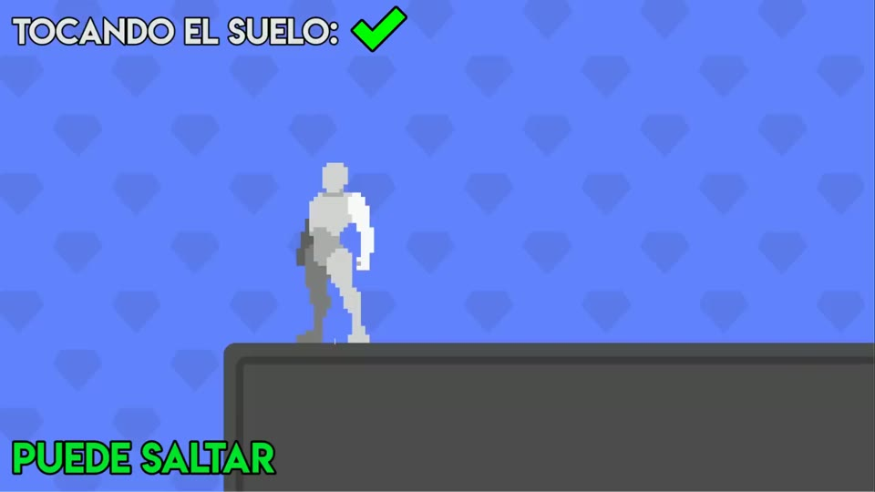
*2:52 — Tocando el suelo: puede saltar*

**[2:54]** Ahora debemos hacer que si el personaje deja de tocar el suelo, hayan unas milésimas de segundo en las que aún pueda saltar, a pesar de que el Raycast no detecte el suelo. Creamos una variable tipo Float llamada tiempo en el aire. Cuando el Raycast no toque el suelo, le sumaremos time.deltatime. Y cuando toque el suelo, la reiniciaremos a cero. Ahora esta variable equivale a los segundos que ha estado el jugador en el aire. Comprobamos que tiempo en el aire sea menor a 0,25, que equivale a una cuarta parte de un segundo. Si es menor, entonces sí que puede saltar.

**[3:25]** Este 0,25 es el tiempo que le damos al jugador de Coyote Time. Si lo pones a 1, el jugador tendrá un segundo entero para saltar después de haberse despegado del suelo. Para el ejemplo he usado un solo Raycast, pero en un juego de verdad deberías tener al menos 3 para cubrir todo el sprite. Además, ahora mismo podrías hacer un doble salto, porque cuando estás en el aire después de saltar, el juego lo detecta como si estuvieras cayendo. Así que ten en cuenta esas cosas y no seas tan retrasado de copiar el código directamente. Ahora que sabes cómo implementarlo, puede que te preguntes, ¿cuánto debería durar exactamente el Coyote Time?

**[3:58]** ¿Cuántos segundos o cuántos frames sería lo óptimo? No hay una respuesta para esa pregunta porque depende del juego, de lo rápido que se mueva el personaje y de lo fuerte que sea la gravedad, entre otras cosas. No te preocupes por elegir un margen que sea matemáticamente exacto y simplemente haz pruebas y elige lo que se sienta bien. Lo que quieres es un margen que te permita saltar justo al final de una plataforma con facilidad, pero que no sea tan exagerado que se note claramente que el personaje está saltando en el aire. Pasemos al segundo truco, también muy básico y también muy frustrante cuando lo haces. Se trata del tamaño de los colliders. Este ya lo he mencionado en otros vídeos y se trata de que el collider de los enemigos o las cosas en general que te matan deberían ser más pequeños que su sprite. Esto es por el mismo motivo que el Coyote Time, para que no dé la sensación de que un objeto o un enemigo te ha matado cuando no te ha llegado a tocar.

**[4:38]** Es mejor pasarse y que se vea que traspasas un poco alguno de los obstáculos que quedarse corto y parezca que te han matado sin tocarte. Para objetos que el jugador sí quiere tocar, podrías incluso hacer lo contrario y poner los colliders un poquito más grandes. Por ejemplo, para que sea más fácil coger monedas y no te quedes sin una por un poquito. En algunos casos, puede que incluso quieras combinar ambas cosas poniendo dos colliders diferentes.

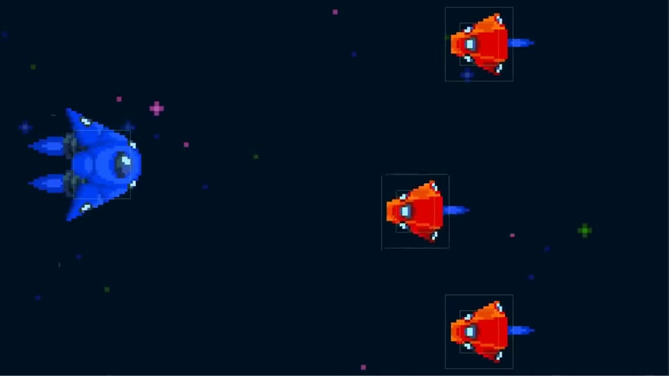
*4:56 — Juego de naves: collider pequeño para morir, grande para recibir disparos*

**[4:57]** Uno más generoso y otro más reducido. Por ejemplo, en un juego de naves, que los enemigos tengan un collider más pequeño, que es el que se usa para controlar si han tocado al jugador, y otro más grande, que es el que registras si les has dado un disparo. ¡Hola! La manera más sencilla de tener dos colliders en un objeto es crear dos capas. Las llamaremos colisiones 1 y colisiones 2. En los ajustes del proyecto, en el apartado de físicas 2D, podemos encontrar una matriz de colisiones.

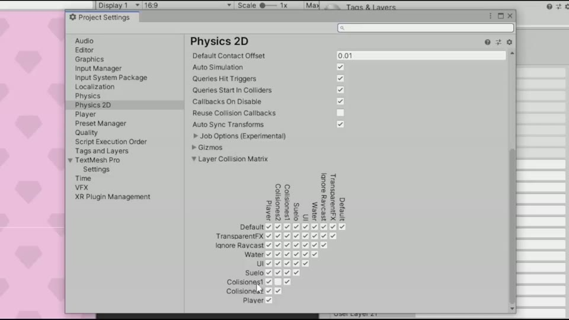
*5:20 — La matriz de colisiones de Physics 2D*

**[5:22]** Queremos que los objetos en la capa 1 no colisionen con los de la capa 2. Así que tenemos que desmarcar esta intersección. Ahora, tan sólo tenemos que crear el objeto con un collider y ponerlo en la capa colisiones 1. Y dentro de este objeto, crear otro objeto con collider y ponerlo en la capa 2. ¡Y listo! El collider de la capa 1 tan sólo colisiona con el suelo que está en la capa 1. Y lo mismo para la capa 2.

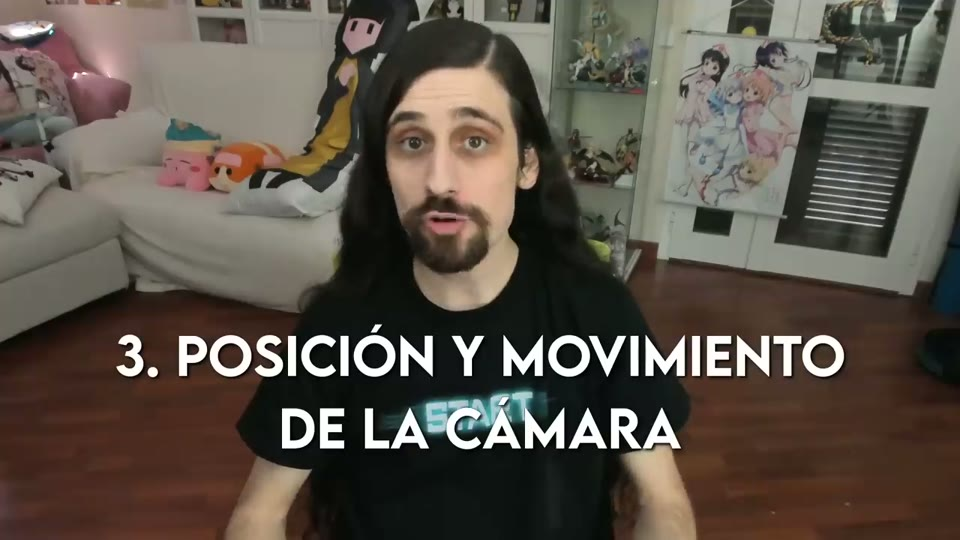
*5:45 — 3. Posicion y movimiento de la camara*

**[5:45]** Pero esto ya es llevarlo al extremo. Para la mayoría de casos, basta con que hagas los colliders que te matan un poquito más pequeños y problema solucionado. El tercer truco es la posición y el movimiento de la cámara. Generalmente, no quieres que la cámara siga perfectamente al personaje porque eso hace que el mundo entero se mueva constantemente y da un poco de mareo. Tampoco quieres que el personaje esté centrado porque la parte que ya has recorrido no te interesa tanto como la que tienes por delante. Tampoco quieres cambios bruscos que hagan que la cámara se mueva rápidamente de un lado a otro. Me han enviado juegos en los que la cámara está desplazada hacia donde mira el personaje pero cambia de lado de golpe cada vez que te mueves en la otra dirección, haciendo que te duela la cabeza bastante rápido. Por último, la cámara tiene que estar a una distancia adecuada del personaje.

**[6:21]** No tiene que estar tan cerca que no veas lo suficiente a tu alrededor, pero tampoco conviene que esté tan lejos que tu atención vaya a estar solo en una pequeña parte de la pantalla. Relacionado con esto, siempre se tiene que poder ver hacia dónde vas. Nunca tienes que poder estar en una plataforma o un acantilado desde el que no se ve la siguiente plataforma y no sabes si es que no es por ahí o es que tienes que saltar muy lejos o es que te tienes que dejar caer y confiar en que habrá suelo debajo. El jugador no es adivino y, además, hacer este tipo de cosas hace que te sientas desorientado porque no está claro hacia dónde vas. ¡Hola! Para hacer una buena cámara utilizaremos una herramienta de Unity llamada... Cinemachine.

**[6:51]** Así que tenemos que ir a la ventana de paquetes e instalarlo. Una vez instalado, creamos una cámara 2D y la ponemos en la posición en el eje Z. En este apartado arrastraremos el objeto al que queremos seguir con la cámara, que en nuestro caso es el jugador. Con los ajustes predefinidos, la cámara no está mal. Pero nos interesa que mire un poco más hacia arriba, así que subiremos esta variable a 0,65.

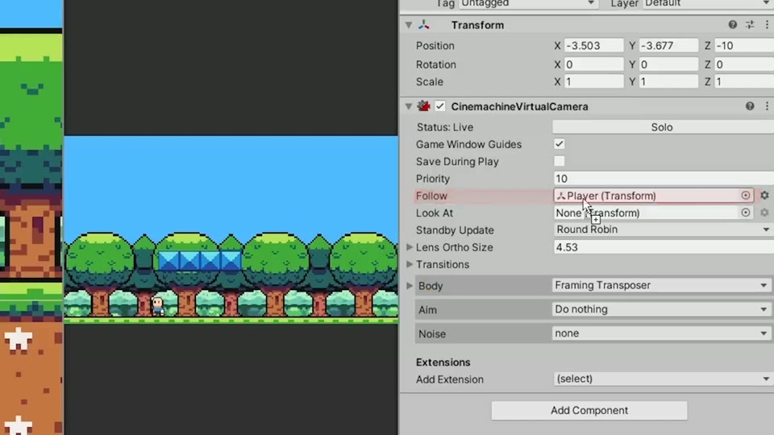
*7:12 — Cinemachine: lookahead y suavizado*

**[7:14]** Y para lograr que la cámara mire hacia la dirección a la que caminamos, pondremos... 0,5. Cuanto más alto este número, más lejos mirará la cámara. También pondremos Lookahead Smoothing a 6. Cuanto más alto este número, más suave será el movimiento de la cámara al mirar hacia adelante. Para acabar, activaremos esta casilla para evitar que la cámara se vuelva loca cuando nuestro personaje salta. ¡Y listo!

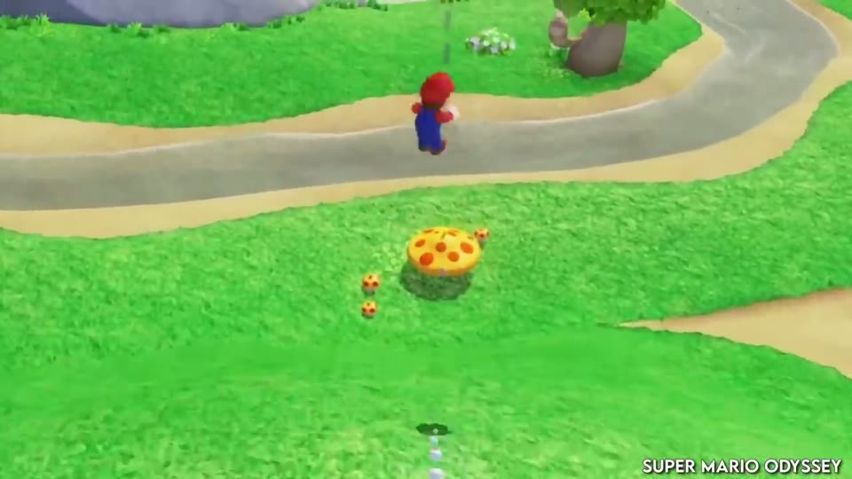
*7:36 — Super Mario Odyssey*

**[7:36]** Ya tenemos una cámara genérica para un juego de plataformas. Pasemos ahora a un truco un poco más avanzado, el Input Buffer. Se trata de dar más margen a la hora de pulsar botones. Un poco como el Coyote Time, pero al revés. Vamos a usar de ejemplo el famoso triple salto de Super Mario. Para poder hacer un triple salto tienes que saltar 3 veces seguidas, pero tener que pulsar el botón exactamente cuando los pies de Mario tocan el suelo sería demasiado exigente. En su lugar, hacemos que si el botón de saltar se pulsa un momento antes de que el jugador toque el suelo, el juego lo guarde y realice el salto cuando sus pies llegan a tocar el suelo de verdad. Para hacerlo todavía más fluido, podríamos añadir también un pequeño margen por detrás para darle tiempo a saltar después de haber tocado el suelo.

**[8:10]** Esto se usa también bastante en el caso de tener un combo de ataques, y aquí puedes ser todo lo generoso con el tiempo que quieras sin que nada parezca que está fuera de lugar. Es habitual que si el personaje tiene un combo de golpes, puedas hacer toda la combinación seguida en el mando y que el personaje la ejecute a su tiempo sin tener que esperar a que empiece a hacer cada movimiento antes de pulsar el siguiente botón. En realidad, ni siquiera hace falta que tengas algún tipo de combo, el input buffer se suele usar también para el salto normal. Y para saltos en la pared fluidos y agradables, es habitual usar tanto el input buffer como el Coyote Time para que se registre el salto tanto si le das un poco antes como un poco después.

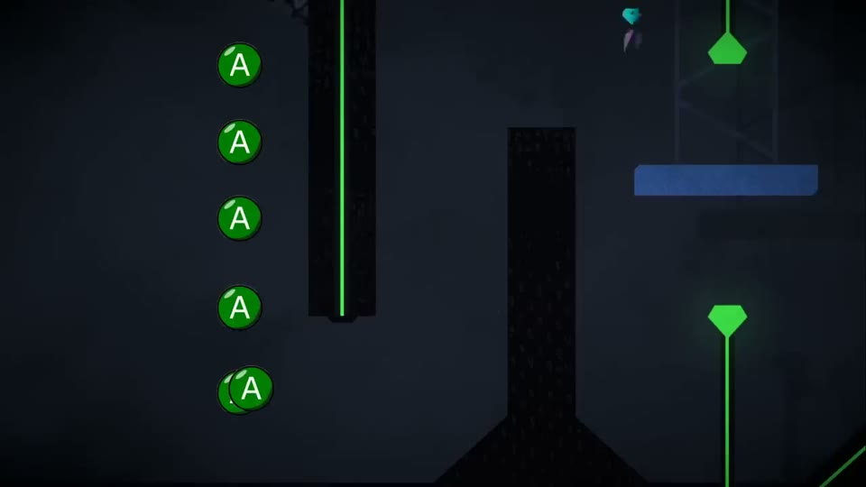
*8:38 — Input buffer: pulsaciones guardadas antes de tocar el suelo*

**[8:41]** El resultado es un juego mucho más agradable de jugar porque es más fácil controlar al personaje y que haga los movimientos que quieres que haga, y visualizarlo. Y evitarse la sensación de que tú le has dado al botón pero el juego no ha respondido. ¡Hola! Una vez más, este es el código con el que movemos el personaje y hacemos que salte. Para hacer el input buffer utilizaremos una Queue que almacenará variables tipo keycode y la llamaremos input buffer. Una Queue funciona como una lista en la que puedes meter variables y se ordenan automáticamente por orden de entrada,

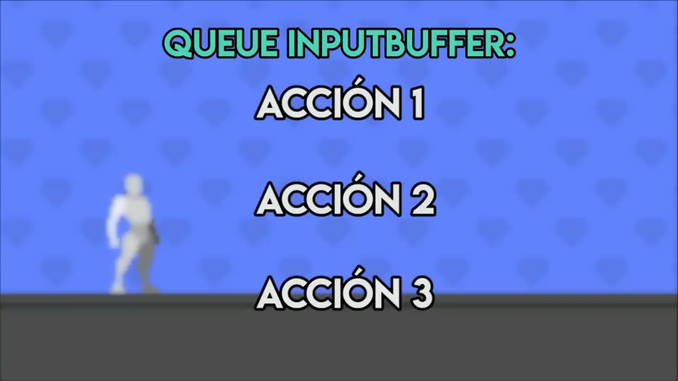
*9:03 — La cola (Queue) del input buffer*

**[9:08]** para que cuando quieras puedas sacar esas variables en el mismo orden en el que han entrado. Ahora mismo, cada vez que pulsamos espacio y se está tocando el suelo, el jugador salta. Vamos a reemplazar esta parte y haremos que cada vez que pulses espacio, se guarde la acción de pulsar espacio en la Queue que hemos llamado input buffer. Es decir, si pulsamos espacio cinco veces, input buffer almacenará la acción de pulsar espacio cinco veces. Ahora, cuando el personaje esté en el suelo, comprobaremos si hay alguna acción guardada en la lista. Si hay al menos una acción, comprobaremos si la siguiente acción de la lista es pulsar el espacio.

**[9:42]** Porque en esta lista podríamos meter acciones que no sean pulsar el espacio. Por ejemplo, pulsar el botón de pulsar. Si esto es cierto, entonces haremos que el personaje salte y quitaremos la última acción de la lista. Ahora mismo, si pulsamos el espacio cinco veces seguidas, el jugador hará los cinco saltos uno tras otro. Pero nosotros queremos que solo salte cuando le das al espacio justo antes de tocar el suelo. Para ello, haremos que cada vez que se añada una acción a la lista, medio segundo después se borre. Así solo funcionará el input buffer si pulsas medio segundo antes o menos de tocar el suelo. Pasemos al quinto truco al que vamos a llamar corrección de espacio.

**[10:17]** Este es un poco más específico, pero dependiendo del juego puede ser la diferencia entre el cielo y el infierno. ¿Qué pasa si quieres saltar pero hay una pequeña fracción de un bloque encima del personaje? Pues que se chocará y de una forma un poco rara y frustrante. El truco consiste simplemente en detectar esos casos y hacer que el personaje se recoloque automáticamente para no golpear esa esquina. Este es un truco que ya usaba Super Mario Bros. hace más de 30 años. Si en tu juego es habitual que el personaje tenga obstáculos encima de la cabeza con los que se pueda chocar, este podría ser un truco fundamental.

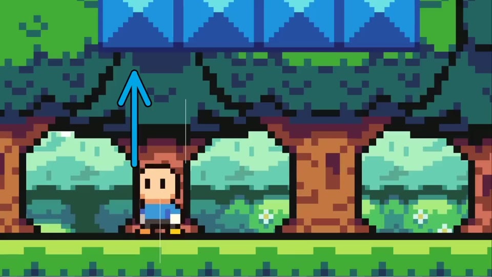
*10:41 — Correccion de esquinas: la cabeza roza un bloque*

**[10:43]** ¡Hola! Para la corrección de esquinas volveremos a utilizar Raycast, pero esta vez hacia arriba. Uno en la esquina superior izquierda de nuestro personaje y otro en la esquina superior derecha. Si el Raycast de la izquierda está tocando algo y el de la derecha no,

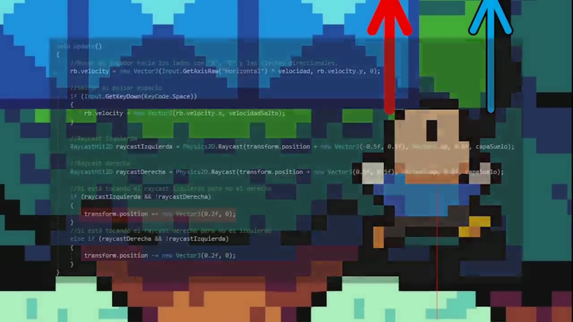
*10:54 — Dos raycasts hacia arriba en las esquinas de la cabeza*

**[10:55]** quiere decir que el jugador se va a dar un cabezazo contra algo que está a su izquierda. Por lo tanto, moveremos al jugador ligeramente hacia la derecha mientras el Raycast esté tocando un obstáculo. Repetimos el proceso con el Raycast de la derecha, pero moviendo al jugador hacia la otra dirección. Este método es poco preciso, pero enseñar una forma de calcular perfectamente al píxel cuánto tenemos que mover al personaje, sería demasiado complejo. Y si te ocurre esto, tan solo tienes que aumentar la cantidad de espacio que mueves al jugador cuando está chocando el Raycast. Pero no lo subas demasiado porque puede quedar bastante mal.

**[11:27]** Sexto truco, vamos a por otro súper básico. Añade feedback. Tiene que estar claro lo que estás consiguiendo con tus acciones e incluso si pulsar un botón se está registrando correctamente. Si le disparas a un enemigo y este ni se inmuta, no entiendes qué está pasando. ¿Es inmune a las balas? ¿Tienes que dispararle 10 veces? ¿Es un bug del juego? Si dispararle le hace daño, debería estar claro.

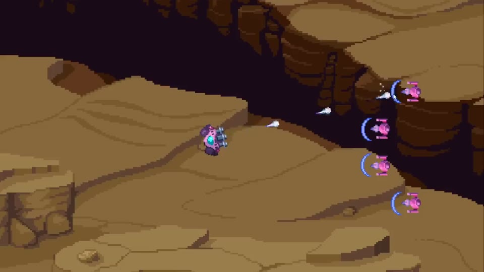
*11:43 — 6. Feedback: el disparo tiene que notarse*

**[11:44]** Y si no le hace daño, también debería estar claro. Con algún tipo de animación o efecto que dé a entender que la bala se ha chocado contra él pero no tiene efecto. Del mismo modo, si se te han acabado las balas y estás intentando disparar, no debería simplemente no ocurrir nada porque a lo mejor no te has dado cuenta y no entiendes por qué la pistola ya no hace nada. En su lugar, tendría que haber como mínimo un sonido, preferiblemente acompañado de algún tipo de animación que te indique por lo menos que el juego está detectando que estás pulsando el botón pero no está teniendo efecto. Idealmente podrías ir más allá y señalar exactamente por qué no está teniendo efecto, haciendo que el contador de balas se agite o algo así. Séptimo truco.

**[12:16]** Diferentes alturas de salto. Vamos a empezar por la absoluta base de cómo debería funcionar un salto. Primero, el personaje se despega del suelo a máxima velocidad. Cuando se acerca a su altura máxima va frenando hasta que se para por completo y finalmente empieza a acelerar en la dirección contraria hasta que alcance una velocidad máxima y luego presumiblemente se pare al tocar el suelo.

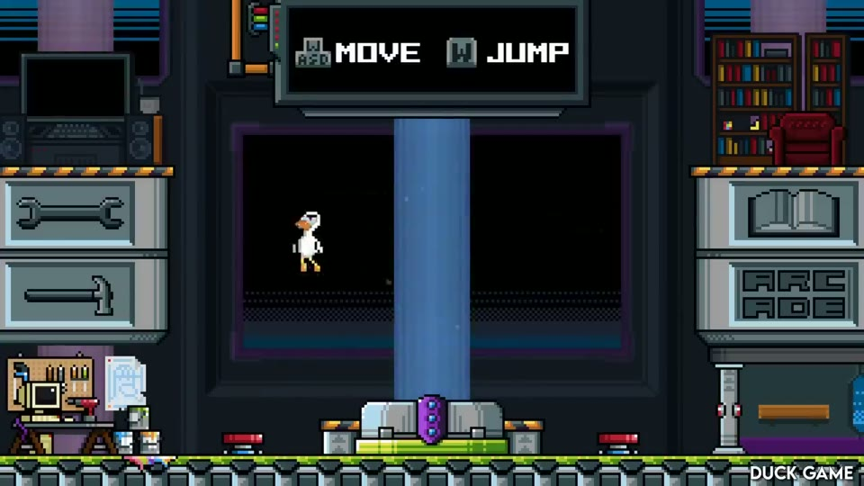
*12:33 — 7. Diferentes alturas de salto*

**[12:33]** Dentro de esta base puedes modificar mucho las físicas para conseguir diferentes tipos de juegos. Hay juegos donde el personaje flota bastante, dando más facilidad para moverse por el nivel y hay juegos en los que el personaje parece un plomo, que normalmente son más rápidos, intensos y precisos. Elige el que quieras, el que mejor encaje con el tipo de juego y niveles que quieras hacer, pero elígelo bien. Dedícale tiempo a ajustarlo para que se sienta bien y encaje con el resto del juego. El truco para mejorar la jugabilidad aquí es ajustar la potencia del salto, llegando más alto si mantienes el botón pulsado o haciendo un salto más chiquito si le das muy rápido. Ni siquiera necesitas que se pueda regular mucho el salto, muchas veces simplemente hay dos o tres alturas fijas que se deciden en función de cuánto tardas en soltar el botón.

**[13:08]** ¡Hola! Primero comprobamos si el jugador está manteniendo el botón de saltar, que en este caso es el espacio.

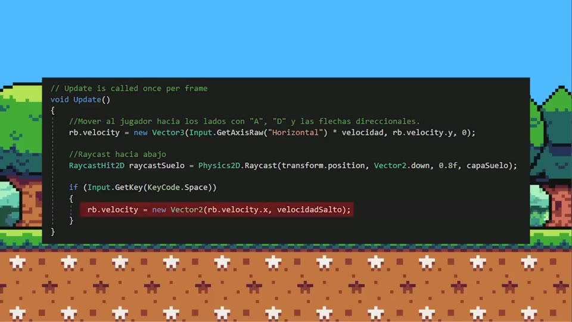
*13:10 — Salto variable con un tiempo maximo de salto*

**[13:14]** Si lo está manteniendo, entonces aplicamos velocidad hacia arriba para que el jugador salte. De esta forma, en cuanto el jugador deje de pulsar el botón de saltar, comenzará a caer. Pero así el jugador podría mantener el botón infinitamente e irse volando. Así que vamos a añadir un temporizador para limitar la altura máxima del salto. Creamos la variable tiempo máximo de salto y hacemos que si se está manteniendo el botón y esta variable es menor de 0,2 segundos, se aplique velocidad hacia arriba. Y además se sume time.deltaTime a la variable. De esta forma limitamos la altura máxima a la que se puede saltar.

**[13:47]** Y para acabar debemos reiniciar la variable tiempo máximo de salto cada vez que el jugador toque el suelo. Si quieres que el jugador pueda saltar más alto, tan solo tienes que cambiar el 0,2 a un número más alto. Pero una vez más, si lo pones demasiado alto, parecerá que puede volar.

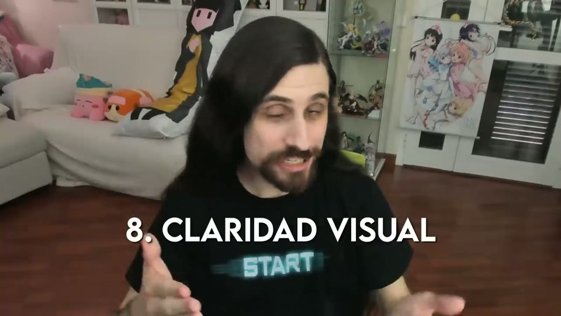
*13:59 — 8. Claridad visual*

**[14:03]** ¡Octavo! Otro muy básico pero que no veo que se aplique suficientemente a menudo. Claridad visual. Tiene que estar muy claro lo que es parte del fondo y lo que no para evitar confusión.

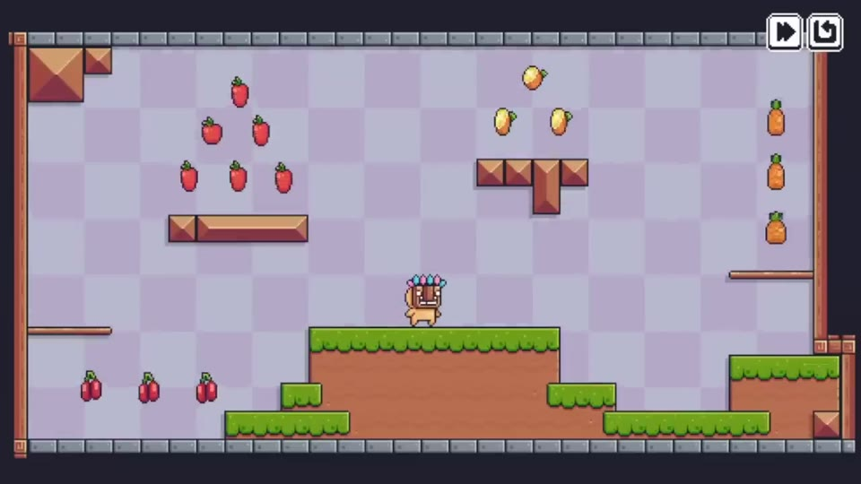
*14:11 — Elementos claros contra el fondo*

**[14:11]** El fondo no tiene que estar muy recargado y definido, porque entonces hace que sea más difícil identificar el resto de elementos. Todos los elementos tienen que verse claramente y a ser posible, indicar también claramente lo que hacen. Un fallo que veo a menudo es hacer que las balas tengan un tamaño realista y por lo tanto sean un par de píxeles. Eso no solo hace que sean difíciles de ver, sino que también quedan mal y se sienten mal, ya que da la sensación de que te está picando un mosquito. Incluso cuando eres tú el que dispara proyectiles, da una mala sensación si no se pueden ver claramente. Aunque no sea realista, deberías hacer tanto los proyectiles como cualquier otro elemento importante del juego claramente visible, especialmente en un juego de acción.

**[14:43]** Por último, el noveno truco es diseñar buenos niveles. Este es un tema muy amplio que da para varios vídeos, pero mucha gente no controla ni lo más básico, así que voy a dar una lección muy resumida. El diseño de niveles en realidad se resume en pensar en lo que estás poniendo en el nivel. Empieza por hacer el nivel en pequeñas secciones en vez de intentar hacerlo todo de golpe. Luego, para cada sección, intenta pensar en una combinación de movimientos que sea interesante. Aquí viene el verdadero truco. Es muy difícil, por no decir imposible, diseñar un nivel interesante con solo uno o dos elementos. El problema que tienen muchos juegos que me envían es que solo hay plataformas. Entonces, una vez que has puesto unas cuantas plataformas a diferentes distancias y alturas, no hay mucho más que puedas hacer.

**[15:19]** La solución es tener más elementos que puedas combinar. Plataformas móviles, pinchos, monedas, enemigos con diferentes patrones, todo eso es lo habitual. A ser posible, deberías tener también algunos elementos que sean únicos de tu juego para que no sea un juego genérico, pero lo importante para que sea divertido es que tengas suficiente material para combinarlo de formas interesantes a la hora de diseñar un nivel. Y otro truco, la parte visual cuenta más de lo que piensas. Que el nivel no parezca estar hecho con bloques de LEGO también ayuda a que se perciba como algo más variado y divertido. Tal vez en este trozo, en vez de haber solo suelo, hay un puente. Jugablemente es exactamente lo mismo, pero visualmente es más interesante y parece un área particular y no un bloque genérico.

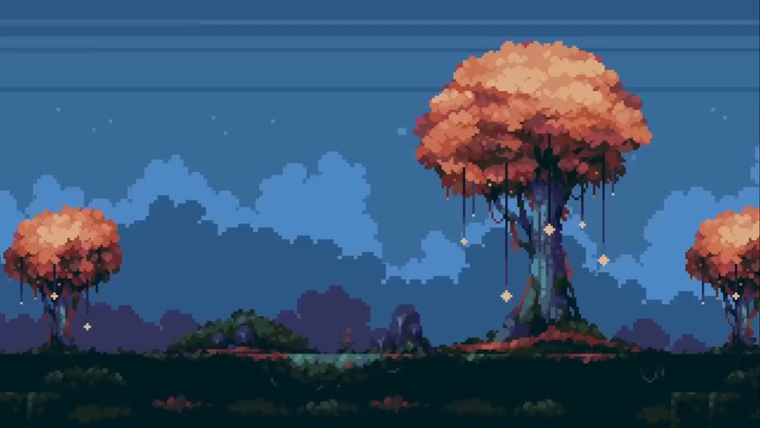
*15:50 — 9. Que el nivel parezca parte de un mundo*

**[15:53]** Tal vez aquí añades unas paredes y un techo haciendo que sea como una cueva. En general, intentar que el nivel parezca parte de un mundo en vez de simplemente plataformas volando hace que sea más interesante y divertido.

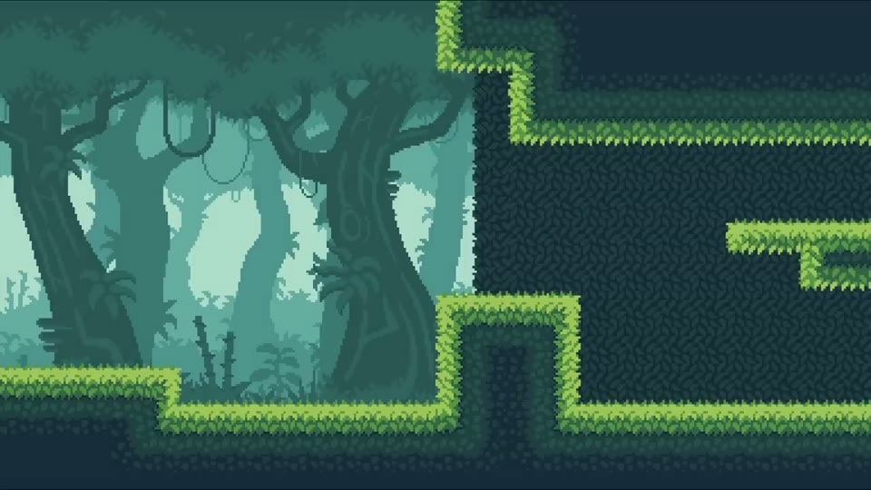
*16:02 — Una cueva en vez de plataformas flotando*

**[16:02]** Eso es todo, espero que vuestros juegos aumenten un poco el nivel a partir de ahora. Suscríbete si no lo estás ya y nos vemos en el próximo vídeo. ¿Todavía estás ahí? Pues deja que te recomiende comprarte mi último juego, Pureya, un juego que cambia cada 10 segundos. Divertido y adictivo, perfecto para jugar en el móvil y también disponible para PC. Link en la descripción.
