# JUICE: la clave para que un juego se sienta vivo

- **Canal:** Guinxu
- **Video:** <https://youtu.be/SuPYE7eN0js>
- **Publicado:** 2021-02-18 · **Duracion:** 10:55
- **Transcripcion:** Whisper large-v3 (GPU, beam 10, idioma es) revisada a mano en nombres propios

## Resumen

El **juice** (o *game feel*) es la sensacion que recibe el jugador cuando interactua con el juego. Un juego es *juicy* cuando cada accion se nota: si te golpean piensas "¡ah!" en vez de "bueno, me ha golpeado". Guinxu repasa tecnicas de otros juegos y luego las aplica a **Flatworld**, su juego:

| Tecnica | Ejemplo en el video | Que transmite |
|---|---|---|
| **Squash & stretch** (deformar objetos) | Jak and Daxter se estira al caer y se aplasta al aterrizar "como gelatina"; la bola del pachinko de Pureya se deforma antes de abrirse | Movimiento, peso, materiales |
| **Sonido** acompañando la animacion | El plastico estirandose y el "pop" del vacio en Pureya | Satisfaccion |
| **Temblor de camara** (*screen shake*) | Hollow Knight al recibir un golpe, al pegar y hasta al romper un cartel | Impacto, "despierta, te atacan" |
| **Particulas + congelar unos frames** | Hollow Knight al recibir daño | Que sea imposible no darse cuenta del golpe |
| **Camara que se acerca y tiembla** mientras te curas | Hollow Knight concentrando el alma | Esfuerzo, intensidad |
| **Dialogos vivos** | Paper Mario: letras que aparecen poco a poco, pausas, letras que tiemblan | Emocion y tono de quien habla |
| **Camara con inercia** | Hollow Knight: al frenar, la camara sigue unos pixeles y frena poco a poco | Suavidad, comodidad |
| **Objetivo de camara adelantado** | El cuadrado amarillo de Flatworld se adelanta hacia donde vas | Ver mas de lo que viene |
| **Recibir daño** | Antes: retroceso, parpadeo rojo y -1 vida. Ahora: + temblor de pantalla | Sentirlo "como un tortazo" |
| **Pegar** | Temblor tambien al golpear enemigos | La fuerza del ataque |
| **Morir** | Temblor mas intenso + flash rojo + camara lenta del ultimo golpe | "Que el jugador sepa exactamente por que ha muerto" |
| **Loot** | El objeto que suelta un bicho aparece con squash & stretch | Recompensa que se nota |
| **Cosas pesadas** | Stretch y temblor al caer algo muy pesado | Peso |
| **Puntuacion en dialogos** | Las comas y puntos pausan: "Estoy ocupado, no me molestes" en dos tiempos | Ritmo y facilidad de lectura |

Idea clave: *"La gente disfruta mas de los juegos cuando los vive, cuando los siente"*.

## Como se aplico en Beyond Small

Todo el juice pasa por un gestor nuevo, [`Juice.cs`](../../Assets/Juice/Scripts/Juice.cs), con una sola opcion para regularlo o apagarlo (**Ajustes > Controles > Temblor y efectos de golpe**).

- **Temblor de camara** por "trauma" (golpe flojo, cargado, recibir daño, muerte, jefe que cae, aterrizajes fuertes). Se aplica justo antes de renderizar para no pelearse con Cinemachine.
- **Congelar frames (hitstop)** al pegar (mas largo con el golpe cargado y al matar) y al recibir daño. Respeta las pausas del menu, el mapa y el inventario.
- **Destello rojo** en los bordes de la pantalla al recibir daño y al morir.
- **Muerte con tres efectos** como en Flatworld: temblor fuerte + flash rojo + camara lenta antes del fundido ([`SensacionJugador.cs`](../../Assets/Juice/Scripts/SensacionJugador.cs)).
- **Squash & stretch del jugador**: se estira al saltar y al caer rapido, y se aplasta como gelatina al aterrizar, con nube de polvo y sonido.
- **Squash & stretch de los bichos** al recibir un golpe, y **chispas** en el punto de impacto ([`SensacionGolpe.cs`](../../Assets/Juice/Scripts/SensacionGolpe.cs)).
- **Loot vivo**: lo que suelta un bicho nace desde cero pasandose de tamaño, y se aplasta con polvo al tocar el suelo ([`AparecerLoot.cs`](../../Assets/Juice/Scripts/AparecerLoot.cs)).
- **Muerte de un jefe**: temblor grande y camara lenta.
- **Camara con inercia y adelantada** (lookahead) y un poco mas abierta al correr ([`CamaraViva.cs`](../../Assets/Juice/Scripts/CamaraViva.cs)).
- **Textos vivos** ([`TextoVivo.cs`](../../Assets/Juice/Scripts/TextoVivo.cs)): letras que aparecen una a una con un pequeño "pop", pausas en comas y puntos, y etiquetas `<temblor>` y `<ola>` para el tono. Se usa en los pensamientos de la intro ("¿Por que todo se ve tan... *enorme*?" con la palabra temblando), en los letreros grandes de los jefes y en el objetivo actual.
- **Sonidos** cortos sintetizados por codigo para los golpes fuertes, el dolor, aterrizar, quedarse sin aliento, recoger y el tecleo del texto ([`SonidosJuice.cs`](../../Assets/Juice/Scripts/SonidosJuice.cs)).

## Transcripcion completa

> Cada bloque empieza con su marca de tiempo. Las imagenes son fotogramas del video en ese momento.

**[0:10]** Hay juegos que cuando un enemigo te golpea piensas, pues bueno, me ha golpeado, ¿qué le voy a hacer?

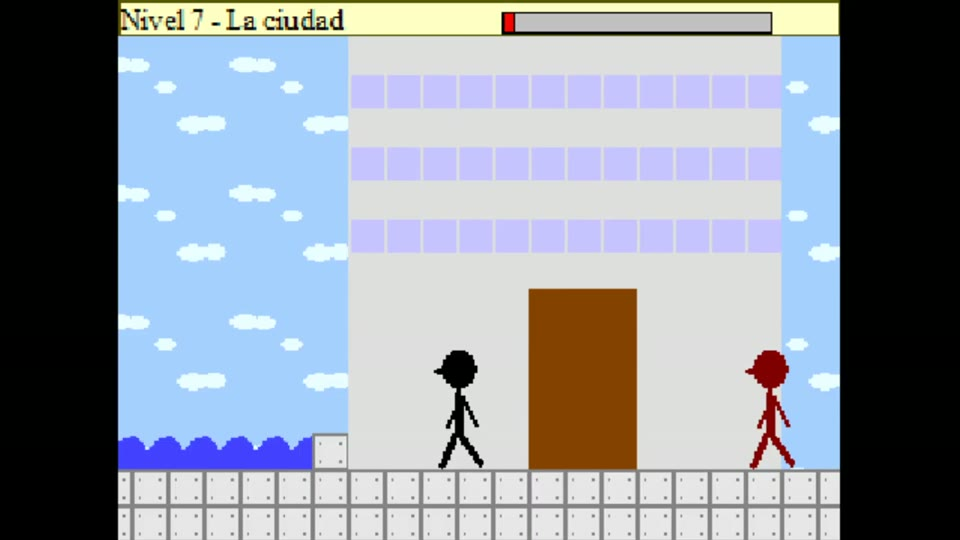
*0:16 — Un juego sin juice: el golpe no transmite nada*

**[0:17]** Mal, no hay sentimiento, no transmites nada al jugador. Esto vamos a decir que no es juicy, pero en cambio en otros juegos te dan y es como, ¡ah!

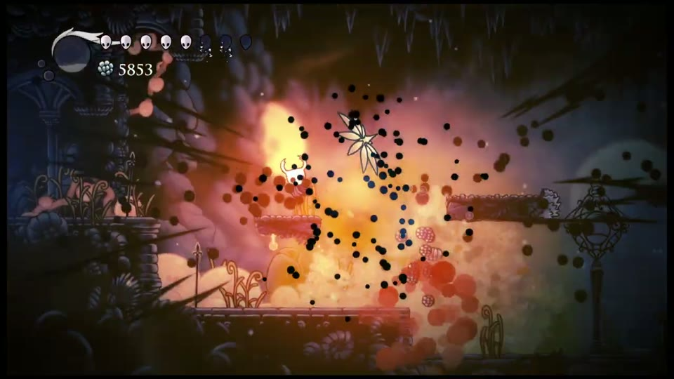
*0:24 — Hollow Knight: recibir un golpe con particulas, temblor y frames congelados*

**[0:30]** Este está muy bien, me ha transmitido mucha tensión.

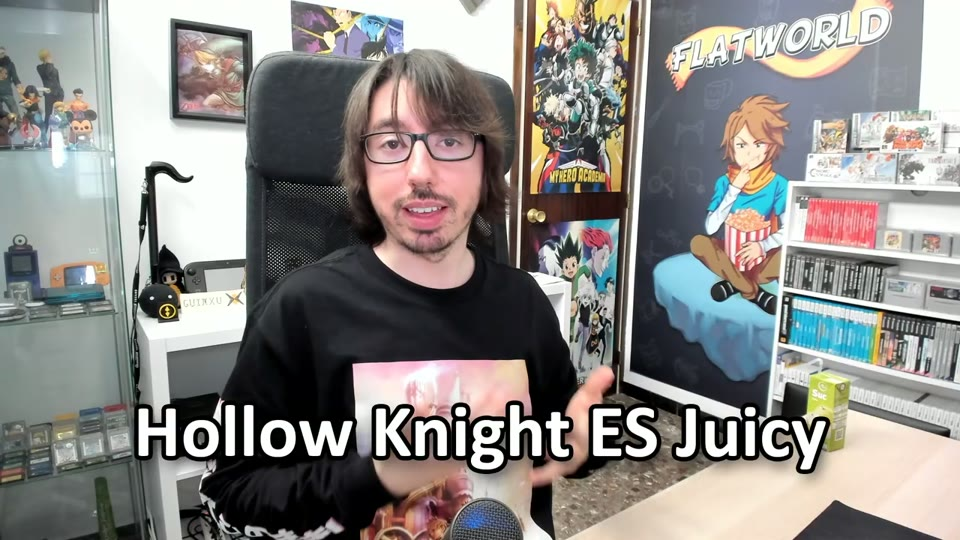
*0:32 — "Hollow Knight ES juicy"*

**[0:33]** Por eso podemos decir que Hollow Knight es muy juicy. ¿Queréis saber qué cambia a nivel interno entre ambos juegos para que la sensación se transmita mejor? Pues tanto si tenéis curiosidad como si estáis haciendo vuestro propio videojuego y os gustaría que fuera juicy, quedaos aquí y yo os contaré todos los detalles. El juice, zumo o jugo en español, es el nombre que se le pone a la sensación que experimenta el jugador cuando interactúa con un videojuego. Se puede llamar game juice o game feel, sensación de juego en inglés. Entonces, si un juego es juicy, ¿significa que transmite bien esas sensaciones?

**[1:11]** En primer lugar, vamos a desglosar algunas de las formas que emplean los videojuegos para volverse juicy. Y luego me vais a ver aplicar varias de ellas a Flatworld, el juego en el que estoy trabajando. De esa manera podréis comparar el antes y el después. Porque, efectivamente, Flatworld no era juicy y no podemos permitirnos quedar atrás. Al final, tú lo que quieres es que el juego se sienta bien, se sienta natural, que los objetos no sean tan rígidos.

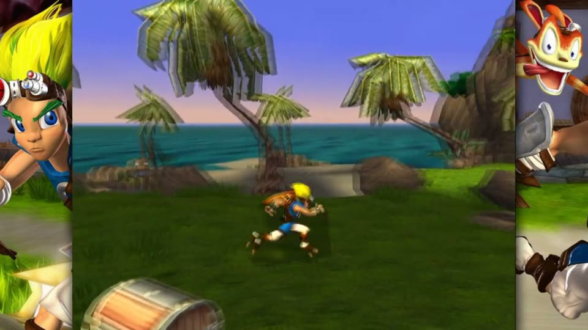
*1:30 — Jak and Daxter: el salto*

**[1:33]** Que el juego sea satisfactorio de jugar. Y una de las maneras de lograrlo es deformar los objetos del juego. Por ejemplo, en el primer Jak and Daxter de PlayStation 2, cuando pegas un salto y caes contra el suelo, se lleva a cabo lo que se llama un stretch and... squash. El personaje al caer se estira, se alarga, para crear más sensación de movimiento. Pero cuando impacta contra el suelo, se aplasta.

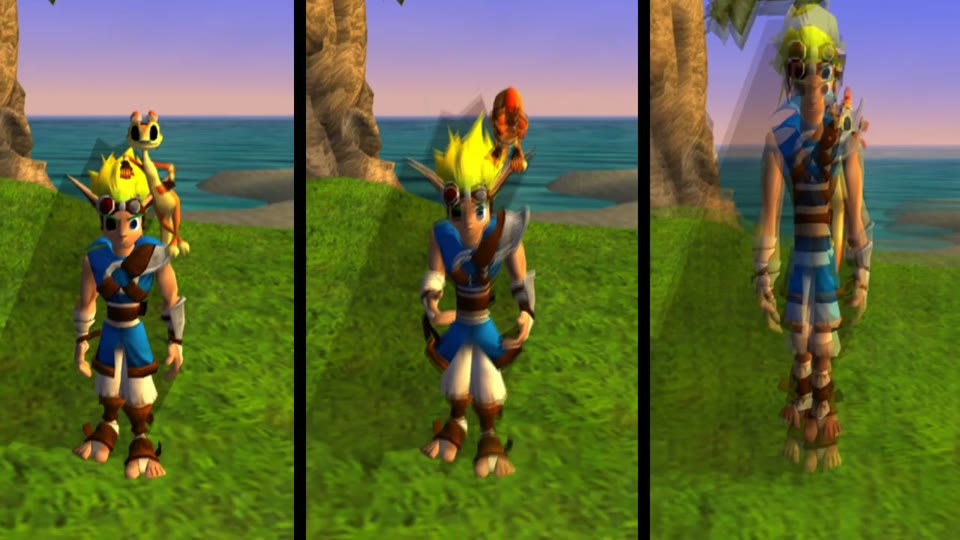
*1:54 — Jak and Daxter a camara lenta: se estira al caer y se aplasta al aterrizar*

**[1:54]** Como si fuera, a lo mejor, de gelatina. Os lo estoy pasando a cámara lenta y estamos comparando diferentes imágenes. Cada vez que salta, hace como... Y esto lo hace Pureya también, y tengo que admitir que me gusta mucho cómo le ha quedado.

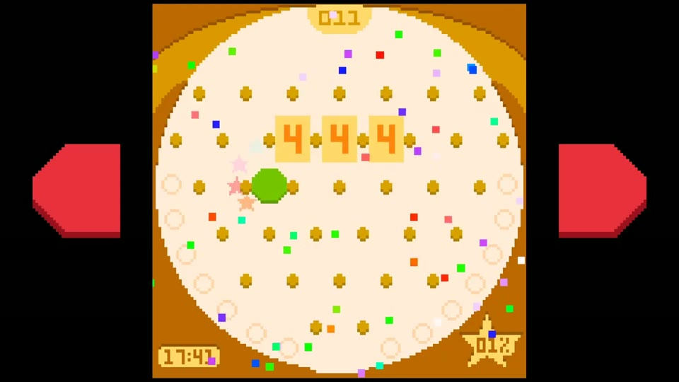
*2:02 — Pureya: la bola del pachinko*

**[2:05]** Cuando consigues un premio en el pachinko, la bola que lo contiene se deforma un poco antes de abrirse para simular que estás estirándola, porque está muy dura, cuesta abrirla, ¿no? Y cuando por fin has separado las dos mitades, hace... Cada parte vuelve a tener sus proporciones originales. Sobre todo, además, con el sonido, gana muchísimo. Juzgadlo vosotros mismos. Y es que el sonido en los juegos hace mucho para mejorar el game juice. No solamente ves que la bola va dura, que están estirando fuerte para abrirla, sino que encima oyes el sonido del plástico estirándose.

**[2:40]** Y como por dentro se hace el vacío, cuando la consigues separar, hace...

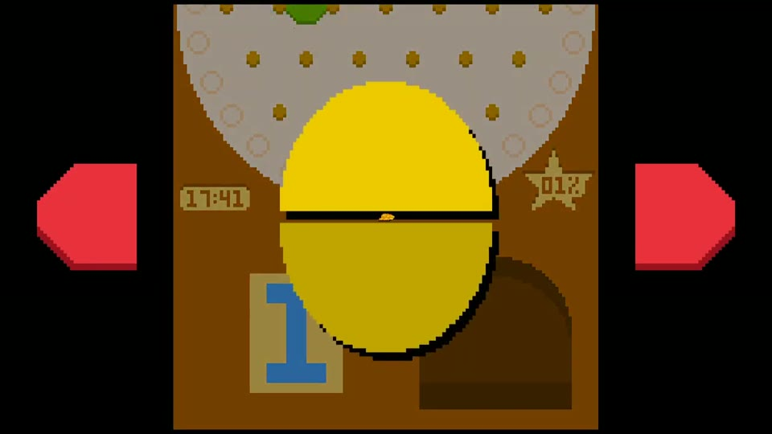
*2:43 — Pureya: la bola se deforma antes de abrirse*

**[2:44]** Y queda muy satisfactorio. Bien, ya hemos hablado de deformar objetos y ahora vamos a pasar a hacer temblar la cámara. A lo mejor de manera más técnica se le podría llamar... Y Hollow Knight es un muy buen ejemplo de esto. Cuando recibes un golpe, la pantalla se sacude para que notes el impacto de verdad. Es como, oye, despierta que te están atacando. Por si no fuera suficiente, además se muestran unos efectos de partículas en la pantalla y el juego se congela durante unos pocos frames.

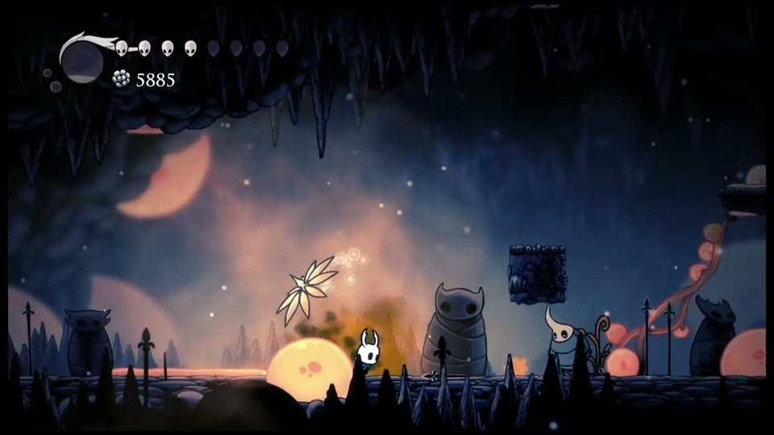
*3:08 — Hollow Knight: temblor al golpear*

**[3:08]** Y de esta manera es imposible que el jugador no se haya dado cuenta de que acaban de golpearle. El juego se siente mucho más vivo. También hay un efecto de sacudir la cámara cuando atacas a un enemigo o incluso cuando rompes un cartel. De esa manera le estás transmitiendo al jugador la fuerza del golpe que acabas de hacer. Y todo eso... Todavía hay más. Cuando estás concentrando tu alma para recuperar vida, podrías simplemente esperar unos segundos y que te suba la vida sola. Pero para hacerlo juicy, como se supone que está concentrando, haciendo fuerza, pues la pantalla se va acercando cada vez más a Hollow Knight mientras tiembla. El protagonista sigue apretando, se sigue concentrando, hasta que por fin consigue curarse una vida.

**[3:42]** Entonces la cámara se relaja, vuelve hacia atrás y deja de temblar. El juice está consiguiendo que el juego se sienta mucho más intenso. Y bueno, en general hay muchos más otros trucos que puedes llevar a cabo para que tu juego sea... ¿Juicy? Hay detalles a lo mejor ya por una línea diferente, como en los diálogos de Paper Mario,

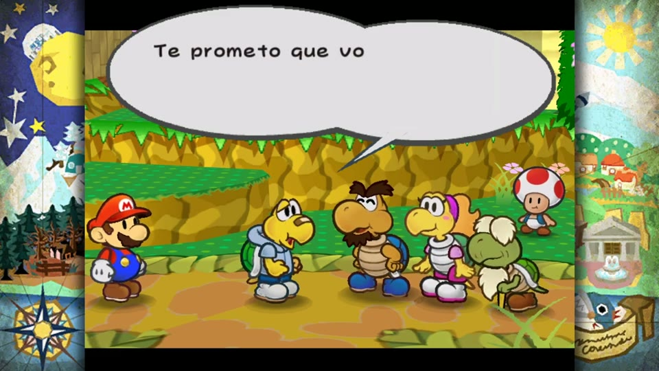
*3:57 — Paper Mario: dialogos con pausas y letras que tiemblan*

**[3:57]** donde para sentir mucho más las emociones de quien está hablando, las letras que aparecen poco a poco hacen pausas en ciertos lugares concretos. Según con el tono que esté hablando un personaje, las letras pueden temblar para enfatizar ese trozo de frase. Y eso convierte a Paper Mario en un juego menos rígido, más vivo, más dinámico. Por último, vamos a volver a Hollow Knight para un detallito. Y es que suavizar el movimiento de la cámara cuando te sigue puede conseguir que el juego se vea mucho más suave y por lo tanto más agradable de jugar. Si os fijáis, voy avanzando y de repente me detengo y la cámara es como que tiene cierta inercia y va frenando poquito a poco.

**[4:29]** No frena de golpe, a pesar de que nosotros sí hayamos frenado de golpe, sino que sigue avanzando unos pocos píxeles más. Sabiendo esto, vamos a aplicárselo a Flatworld, el juego en el que estoy trabajando, para que se vuelva bien jugoso y... ¡Mmm! ¡Sabrosón! Por cierto, ya llevamos 9.500 wishlists en Steam, así que muchísimas gracias por el apoyo, pero Pureya, de Alva Majo, ya va por las 13.000. Así que si os gusta Flatworld, os animo a añadirlo. A vuestra lista de deseados de Steam, a ver si alcanzamos a Pureya y hacemos llorar a Alva Majo. Anteriormente, la cámara de Flatworld era fija justo encima del personaje y lo seguía allá donde fuera al milímetro.

**[5:05]** Si el personaje corría, la cámara corría exactamente a la misma velocidad y si te detenías, la cámara se paraba en seco. Ahora, en cambio, le hemos añadido un poco de juice al juego y cuando avanzas, pues la cámara tarda un poco en frenar. Es como que tiene una inercia, avanzas y es como que todavía tiene que avanzar un poco más ella. Hasta que se vea bien. Y ahora que acaba de frenar igual que tú. Creo que ahora es mucho más suave. Pero no contento con esto, he añadido una segunda mejora

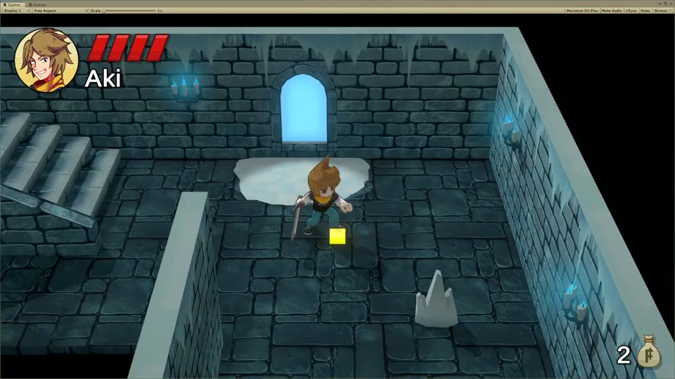
*5:27 — Flatworld: el cuadrado amarillo es el verdadero objetivo de la camara y se adelanta*

**[5:29]** que esto no tiene nada que ver con el juice, pero lo quiero enseñar. El cuadrado amarillo que tenemos a nuestros pies es el verdadero objetivo de la cámara. ¿Qué características tiene este cuadrado amarillo? Pues que cuando nos movemos hacia un lado, el cuadrado se adelanta a nuestra posición. Entonces la cámara siempre va un poco adelantada a nosotros. Nada, es un pequeño detallito que creo que mejora la experiencia de usuario, que puedas ver más. Vamos a hablar ahora de recibir daño. Antes, en el juego, cuando recibías daño, y lo estaréis viendo, simplemente chocabas con el enemigo, retrocedías un poco, parpadeabas, te ponías durante unos frames de color rojo, perdías una vida y ya está, ¿vale?

**[6:01]** Pero considero que era un poco superficial. Entonces quería que el jugador lo sintiera más, que lo viviera más. Y tomando como referencia los juegos que os he enseñado antes, decidí ponerle un screen shake y así es como se ve ahora. Nos acercamos al enemigo y de repente, ¡zas!, la pantalla tiembla. A ver, tampoco tiene que temblar muchísimo, pero lo suficiente como para que despiertes, como quien te da un tortazo en la cara, ¿no? Otra vez, venga. ¿Veis? No sé, creo que se siente mucho más vivo. Y lo mismo cuando hacemos daño a los enemigos. También tiembla la cámara para que se note la fuerza de nuestro ataque, ¿no?

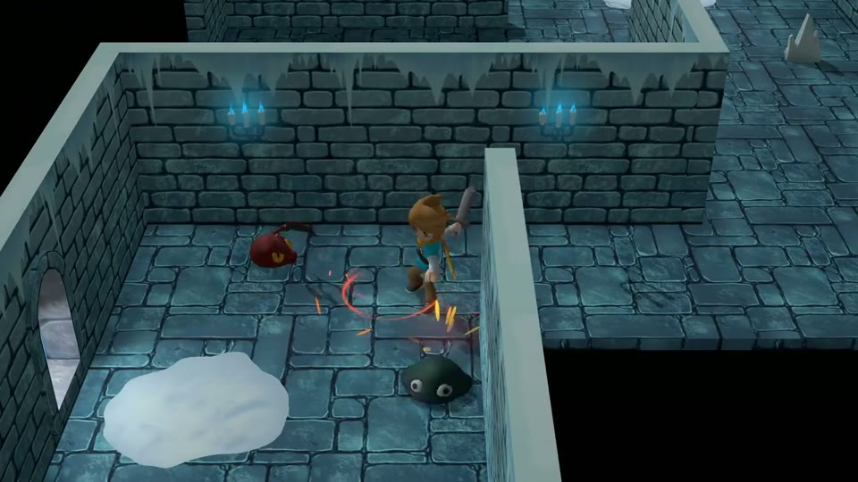
*6:33 — Flatworld: pegar a los enemigos con temblor de camara*

**[6:34]** La intensidad con la que los estamos golpeando. Comparad un golpe como era antes y los golpes como son ahora. Yo creo que el combate es mucho más satisfactorio.

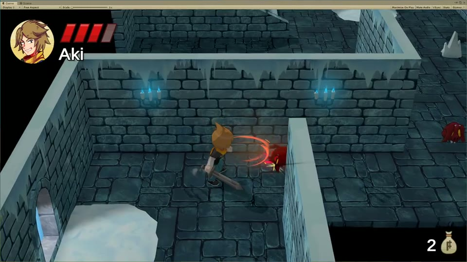
*6:41 — Flatworld: el golpe ahora se siente*

**[6:42]** Creo que el combate ha ganado mucho. Si bien sigue siendo una de las partes más sencillas del juego, creo que ha ganado mucho más. Y ahora es como que tienes más ganas. Luego, llevado al extremo, ¿qué ocurría cuando morías? Antes simplemente te quedabas en cero vidas, animación de caerte al suelo y reiniciaba la pantalla. ¿Ahora qué ocurre? Pues hay una acumulación de tres efectos. Atentos que me voy a dejar morir. Habéis visto, en primer lugar, tiembla la pantalla como antes, pero un poco más intenso. En segundo lugar, aparece un flash de color rojo.

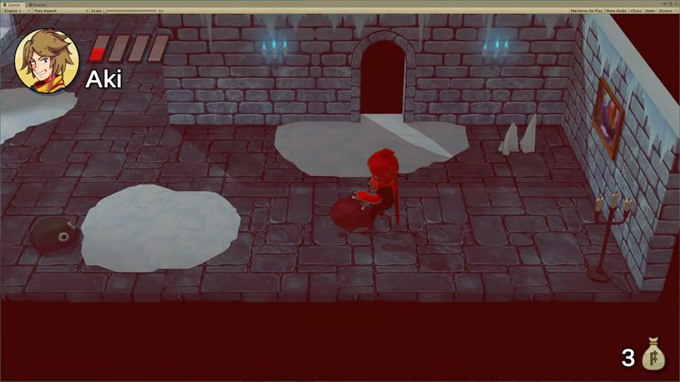
*7:14 — Flatworld: al morir, temblor + flash rojo + camara lenta*

**[7:15]** Y en tercer lugar, la acción se ralentiza para que puedas ver exactamente el último golpe, el golpe que te ha dejado en el suelo, de dónde viene. Y, poco a poco, tu caída hasta quedar en el suelo y reiniciar la pantalla. No quiero que el jugador tenga dudas, que cuando muera sepa exactamente por qué ha muerto. La gente disfruta más de los juegos cuando los vive, cuando los siente. Luego, el loot que sueltan los enemigos. Cuando matamos a un bicho, el objeto que aparece hace un stretch y squash, como hemos visto en las animaciones anteriores de, por ejemplo, Pureya o Jak and Daxter. Antes spawneaba sin ningún tipo de animación y ahora creo que es mucho más, pues precisamente, juicy.

**[7:51]** También he tenido en cuenta los stretch, que son los que se utilizan en el juego. Los stretch y los temblores al caer una cosa muy pesada. Como podéis ver, así nos damos cuenta de lo que pesan las cosas. Por último, voy a hablar de los diálogos y os voy a enseñar la diferencia entre el mismo diálogo, pero un poco más juicy y sin juicy. Esto lo enseñé hace tiempo, pero creo que encaja bien con el vídeo. Ciertas palabras que quiera recalcar yo en los diálogos las puedo hacer temblar.

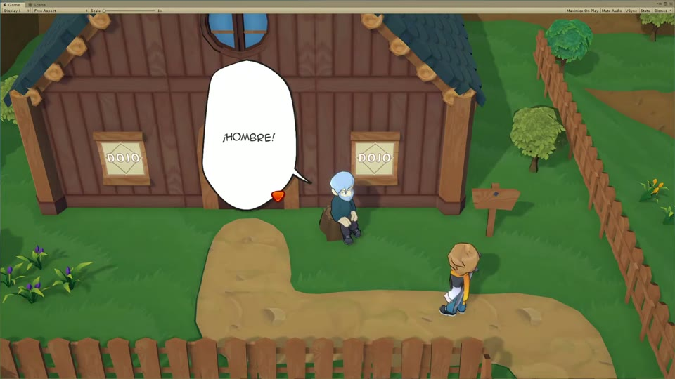
*8:11 — Flatworld: "Estoy ocupado, no me molestes": la coma pausa el texto*

**[8:13]** Cuando un personaje está o bien cantando o bien diciendo algo muy alegremente, las letras bailan. Todo esto transmite un sentimiento. No es solamente leer un texto, sino que, ya sabes, un poco cómo lo dice. Y además, y eso sí que es nuevo, ahora los signos de puntuación pausan durante un periodo pequeño de tiempo. Eso le da un ritmo a la frase, le da más vida, pero también la hace más fácil de leer porque entiendes bien cada parte de la frase por separado. Por ejemplo, aquí, estoy ocupado, no me molestes. Es una frase a dos tiempos y el juego se espera que termine la primera parte antes de empezar con la segunda porque hay una coma. A mi juicio, considero que solo con estos detalles el game feel de Flatworld ha ganado mucho.

**[8:53]** No sé qué pensaréis vosotros. Me interesa que me lo dejéis aquí abajo en los comentarios para saber vuestra opinión. Y nada más. Espero que os haya gustado este vídeo. Espero que os haya parecido interesante. No olvidéis, por favor, a los que os interese añadir Flatworld a vuestra lista de deseados de Steam. Tendréis el link en la descripción y en el comentario fijado. Sin más, me despido. Nos vemos en el siguiente vídeo. Un saludo y hasta la próxima. Se acabó el juicio.

**[9:32]** Es que la gente va a decir que estás tonto porque te bebes un zumo en un vídeo. Quería enseñaros un clip. El otro día estábamos haciendo directo en Twitch con... Alva Majo, Heinau y Depalen. Y yo estábamos jugando. Por cierto, si queréis seguirme en Twitch tenéis el link aquí abajo en la descripción. Y nada, la cosa es que estábamos hablando y quería hacer una prueba de sonido a ver si se escuchaba todo bien. Y este es el resultado. ¿Qué? ¿A qué queréis jugar? ¿Qué queréis jugar? El Sarcón. No, me da igual. Puedo jugar. A ver, tampoco. ¿El qué?

**[10:01]** ¿A qué queréis jugar? ¿A qué queréis jugar? El Sarcón. No, me da igual. Puedo jugar. A ver, tampoco. ¿El qué? ¿A qué queréis jugar? ¿A qué queréis jugar? El Sarcón. No, me da igual. Puedo jugar. A ver, tampoco. ¿El qué? ¿A qué queréis jugar? ¿Qué está repetido? ¿Qué pasa? El Sarcón. No, me da igual. Puedo jugar. ¿Qué está pasando? ¿El qué? ¿A qué queréis jugar? ¿Qué está repetido? ¿Qué pasa? El Sarcón. No, me da igual. Puedo jugar. ¿El qué? ¿A qué queréis jugar? ¿Qué pasa? El Sarcón. No, me da igual. Puedo jugar. ¿El qué? ¿A qué queréis jugar? ¿Qué pasa?

**[10:36]** El Sarcón. No, me da igual. ¿Qué pasa? El Sarcón. ¿Qué está pasando? Ay, ay. ¿Qué ha sido eso?
